<div align="center">

# sqlSchema

**Şema dosyalarını bir yıldız haritası olarak çizen, tarayıcıda çalışan açık kaynak görselleştirici.**<br>
**An open-source, in-browser viewer that draws database schemas as a star map.**


[**Türkçe**](#tr) · [**English**](#en)

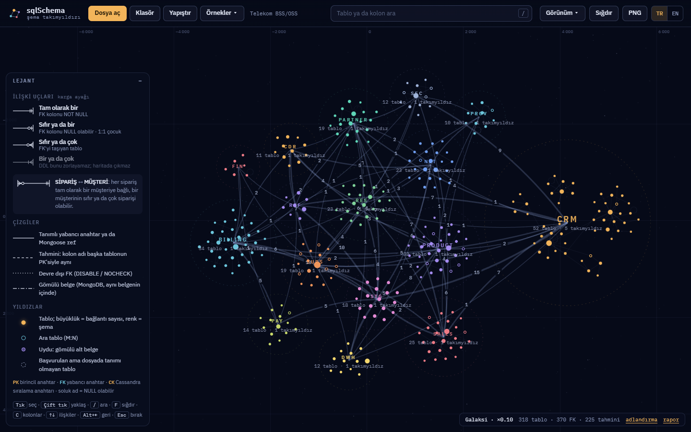

</div>

---

<a id="tr"></a>

## Türkçe

sqlSchema, veritabanı şema dosyalarını tarayıcıda okur ve bir gökyüzü haritası olarak çizer:
- Her tablo bir yıldızdır.
- Her ilişki iki yıldız arasında bir çizgidir.
- Her şema bir gökyüzü bölgesi, her veritabanı bir galaksidir.

Yaklaştıkça yıldızlar kolon listeli tablo kartlarına dönüşür ve ilişkiler karga ayağı (crow's foot) notasyonuyla okunur.

draw.io kadar elle uğraştırmaz, veri modelleme aracı kadar ağır değildir. Amaç, şemaya ilk kez bakan birinin "hangi tablo neye bağlı?" sorusunun cevabını birkaç saniyede görmesi.

### İçindekiler

1. [Öne çıkanlar](#tr-one-cikanlar)
2. [Hızlı başlangıç](#tr-hizli-baslangic)
3. [Haritayı okumak](#tr-haritayi-okumak)
4. [Birden fazla dosya ve migration](#tr-coklu-dosya)
5. [Desteklenen veritabanları](#tr-veritabanlari)
6. [MongoDB](#tr-mongodb)
7. [Adlandırma profili](#tr-adlandirma)
8. [Tasarım denetimi](#tr-denetim)
9. [Örnekler](#tr-ornekler)
10. [Şemayı dışa aktarmak](#tr-disa-aktarma)
11. [Dil](#tr-dil)
12. [Proje yapısı ve geliştirme](#tr-gelistirme)
13. [Sınırlar](#tr-sinirlar)
14. [Katkı, güvenlik, lisans](#tr-katki)

<a id="tr-one-cikanlar"></a>

### Öne çıkanlar

- **Saf HTML, CSS ve JavaScript.** Bağımlılık yok, derleme adımı yok; klasörü açmanız yeterli.
- **Gizlilik:** dosyalar tarayıcıdan çıkmaz, hiçbir sunucuya gönderilmez.
- **Sekiz veritabanı:** Oracle, SQL Server, MySQL, MariaDB, PostgreSQL, SQLite, Cassandra ve MongoDB.
- **Tek dosya, birden fazla dosya ya da bütün bir klasör:** bölünmüş dökümler, migration klasörleri (Flyway, golang-migrate), çok veritabanlı projeler.
- **Karga ayağı notasyonu:** kardinalite `NOT NULL`, `UNIQUE` ve PK bilgisinden çıkarılır.
- **Tahmini ilişkiler:** FK tanımlı olmayan eski sistemlerde, Cassandra'da ve MongoDB'de bağlantılar kolon adlarından bulunur.
- **Adlandırma profili:** şemada hangi adlandırma kalıplarının ne oranda kullanıldığını ve baskın kalıba uymayan tabloları gösterir.
- **Tasarım denetimi:** PK'siz tablo, metin tarih, indekssiz FK gibi hataları neden ve öneriyle listeler.
- **Şema farkı ve zaman çizelgesi:** iki sürümü karşılaştırır, migration'ları sırayla oynatır.
- **Ölçek:** 2 862 tabloluk 4,7 MB'lık bir döküm yaklaşık 0,6 saniyede açılır, bir karenin çizimi 10 ms'nin altında kalır.
- **Türkçe ve İngilizce arayüz.**

<a id="tr-hizli-baslangic"></a>

### Hızlı başlangıç

1. Depoyu indirin ya da klonlayın.
2. `index.html` dosyasını tarayıcıda açın.
3. Şema dosyalarınızı ya da klasörü sayfaya sürükleyin. Alternatifler: **Dosya aç** (birden fazla dosya seçilebilir), **Klasör**, **Yapıştır**, **Örnekler**.

Örnek dosyaları ve sürüklenen klasörleri tarayıcı yalnızca sayfa bir sunucu üzerinden açıldığında okuyabilir. Bunun için proje klasöründe şu komutu çalıştırıp `http://localhost:8000` adresine gidin:

```bash
python -m http.server 8000
```

> `index.html` doğrudan dosyadan (`file://`) açıldığında da uygulama çalışır. Klasörleri sürüklemek yerine **Klasör** düğmesiyle seçin. Gömülü küçük örnek her durumda açılır.

| Hareket | Sonuç |
|---|---|
| Tekerlek / iki parmak | Yakınlaştır |
| Sürükle | Kaydır |
| Tık | Tabloyu seç, ayrıntı panelini aç |
| Çift tık | Tabloya yaklaş, kolonları göster |
| `/` | Tablo ya da kolon ara |
| `F` | Tümünü sığdır |
| `C` | Kolon ayrıntılarını gizle / göster |
| `L` | Tablo listesini aç / kapat |
| `↑` / `↓`, `Enter` | Paneldeki ilişkiler arasında dolaş, seçilen tabloya git |
| `Alt` + `←` / `→` | Gezinme geçmişinde geri / ileri |
| `,` / `.` | Zaman çizelgesinde önceki / sonraki sürüm |
| `Esc` | Odak modunu kapat / seçimi bırak |

<a id="tr-haritayi-okumak"></a>

### Haritayı okumak

Yakınlaştırma düzeyine göre üç görünüm vardır:

| Görünüm | Ne görünür |
|---|---|
| Galaksi | Veritabanları, şemalar ve şemalar arası ilişki demetleri (çizgi üstündeki sayı = ilişki adedi) |
| Takımyıldız | Tablolar yıldız olur: boyut = bağlantı sayısı, renk = şema. Seçili tablonun çizgilerinde karga ayağı ve kolon adı yazar. |
| Yakın plan | Tablolar kart olur; çizgiler doğrudan FK ve PK kolon satırlarına bağlanır. |

**Görünüm** menüsünde tablo listesi, kolon ayrıntıları, tahmini ilişkiler, sözlük bağlantıları, ızgara ve takımyıldız gruplaması seçenekleri var. **Kolon ayrıntıları** kapatılınca (kısayolu `C`) yakın planda kartlar yalnızca tablo adını gösterir ve çizgiler kartın başlığına bağlanır. Böylece yalnızca tablolar ve ilişkileri kalır. Ayrıntı paneli kolonları göstermeye devam eder. Seçim tarayıcıda hatırlanır.

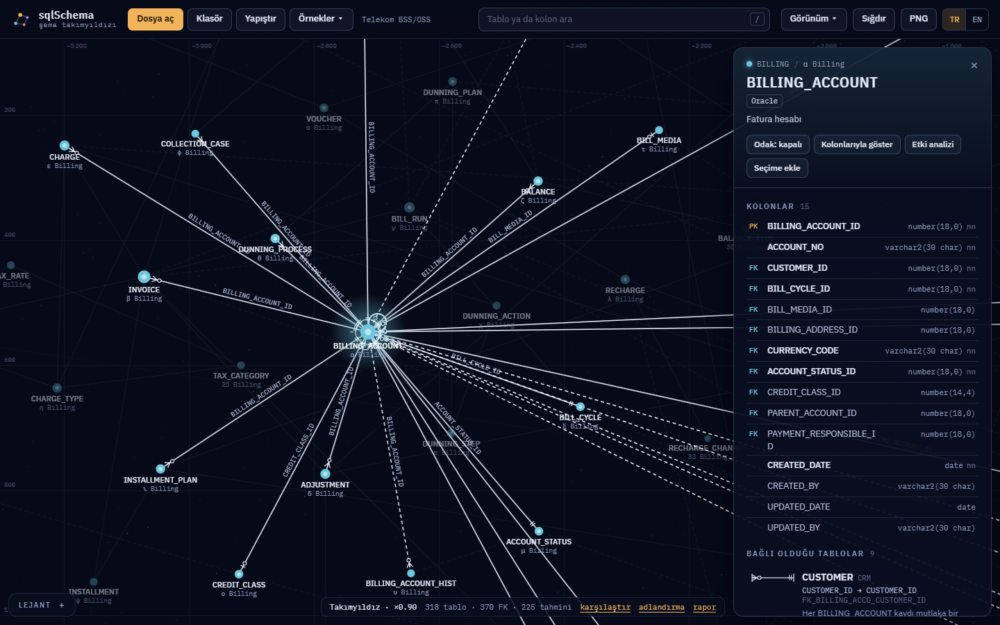

Ayrıntı panelinde kolonlar, açıklamalar, tanımın geçtiği dosya ve satır ile her ilişkinin Türkçe okunuşu yer alır:
*"Her INVOICE kaydı mutlaka bir BILLING_ACCOUNT kaydına bağlı. Bir BILLING_ACCOUNT kaydının sıfır ya da çok INVOICE kaydı olabilir."*

**Odak modu**, seçili tablonun yalnızca 1 ya da 2 adım uzaklıktaki komşularını bırakır, gerisini söndürür.

**İlişki izlemek.** Paneldeki bir ilişkiye tıklamak (ya da `↓` ile seçip `Enter`) o tabloya gider. Panelin üstündeki **iz** gezilen tabloları sırasıyla gösterir (`ABONE › IS_EMRI › CIHAZ`); izdeki bir ada, `‹ ›` düğmelerine ya da `Alt` + `←` / `→` tuşlarına basarak geri ve ileri gidilir. Böylece fareye dokunmadan şema baştan sona gezilebilir.

**Tablo listesi.** Bütün tabloları şema ve takımyıldız başlıkları altında listeler (**Görünüm → Tablo listesi** ya da `L`; varsayılan kapalı):
- **Sıra:** tablolar ya SQL dosyasında tanımlandıkları sırayla (**Dosya sırası**) ya da ada göre (**A → Z**) dizilir.
- **Gezinme:** `↑` / `↓` ile tablodan tabloya geçilir; seçim, panel ve harita birlikte ilerler. Arama kutusundan `↓` ile listeye inilir.
- **Süzme:** listenin üstündeki kutu yalnızca listeyi süzer, haritayı değiştirmez.
- **İşaretler:** her satırda kolon sayısı; PK'si olmayan, ara (M:N), sözlük ve dış tablolar küçük etiketlerle işaretlenir.
- Liste ve lejant aynı kenarı paylaşır; biri açılınca öteki kapanır. Seçim tarayıcıda hatırlanır.

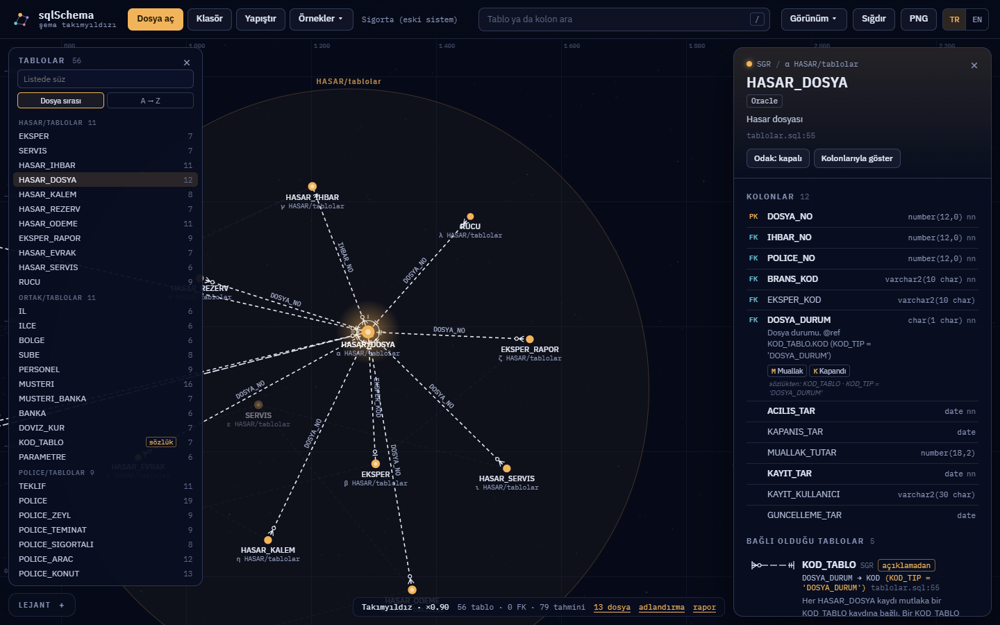

**Alt diyagram.** Büyük bir şemada yalnızca ilgilendiğiniz tabloları ayrı bir haritada görmek için:
- **Seçim:** haritada `Ctrl` / `Cmd` + tık, paneldeki **Seçime ekle** düğmesi ya da tablo listesinde `Ctrl` / `Cmd` + tık. Listedeki takımyıldız başlığındaki **+** bütün takımyıldızı (ör. bir modül dosyasını) ekler. Seçilen tablolar haritada vurgulu bir halkayla işaretlenir.
- **Açma:** üstte beliren çubukta **Alt diyagramı aç**. **Komşularıyla** işaretliyse seçilen tablolara doğrudan bağlı tablolar da gelir.
- **Alt diyagramda:** yalnızca bu tablolar ve aralarındaki ilişkiler kendi yerleşimiyle çizilir; panel, arama, tablo listesi ve adlandırma profili de yalnızca bu tablolara bakar.
- **Dönüş:** **Tümüne dön** ya da `Esc`. Tam harita aynı konumlarla geri gelir.
- **Bağlantı:** `?sub=BILLING_ACCOUNT,INVOICE&near=1` bu alt diyagramı doğrudan açar.
- **Kayıtlı görünümler:** alt diyagramdayken **Kaydet** ile ad verilir. Görünümler tarayıcıda, açılan dosya kümesine göre saklanır; aynı dosyalar yeniden açılınca **Görünüm → Kayıtlı görünümler** altında durur. **Dışa aktar** bunları `.sqlschema.json` dosyasına yazar, **İçe aktar** geri okur. Dosya yalnızca görünümü (tablo adlarını) taşır, şemayı içermez; ekip içinde paylaşmak için uygundur.

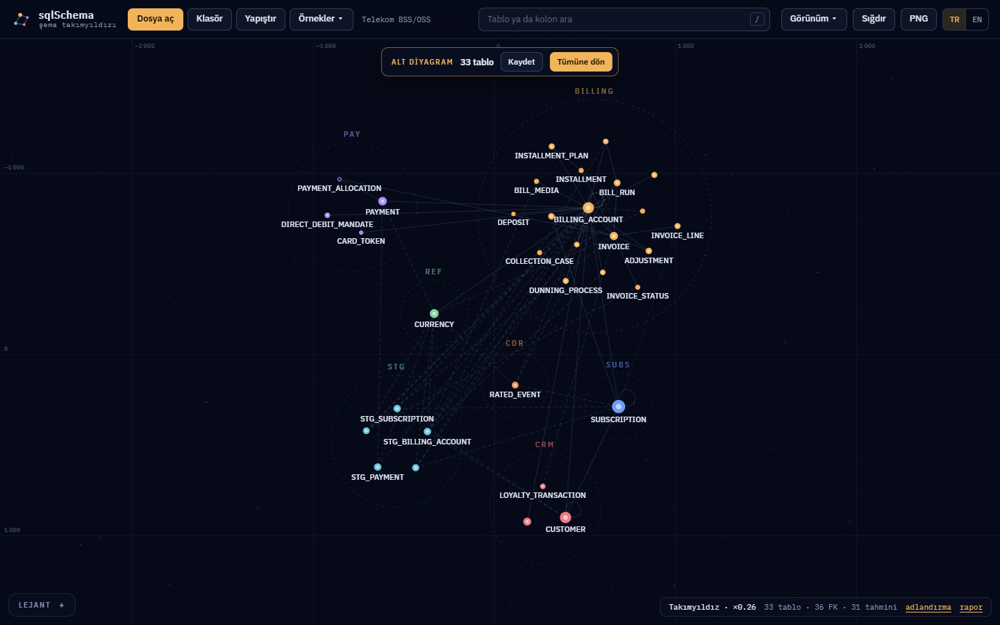

**Etki analizi.** "Bu tabloyu değiştirirsem ya da bir satırını silersem ne etkilenir?" Paneldeki **Etki analizi** düğmesiyle açılır:
- **Etkilenenler:** tabloya bağlanan bütün tablolar derece derece listelenir (1. derece doğrudan bağlananlar, 2. derece onlara bağlananlar …). Haritada etkilenmeyenler söner, etkilenenler dereceye göre renkli halkayla işaretlenir.
- **Silmede ne olur:** her bağlantının yanında yazar: **birlikte silinir** (`ON DELETE CASCADE`), **boşaltılır** (`SET NULL`), **silmeyi engeller** (eylemsiz FK), **denetlenmez** (`@ref`, tahmini ya da devre dışı FK: veritabanı korumaz, yetim satır kalabilir).
- **Birlikte silinenler:** bir satır silinince CASCADE zinciriyle giden tablolar ayrıca gösterilir.
- **Kolon düzeyi:** analiz açıkken paneldeki bir kolona tıklamak yalnızca o kolona bağlananları bırakır (ör. PK'nin tipini değiştirmeden önce).
- **Paylaşım:** **Markdown indir** sonucu değişiklik öncesi ekiple paylaşmak için dosyaya yazar. Kip seçimi izler; başka bir tabloya geçince analiz onun için yenilenir. `Esc` kapatır.

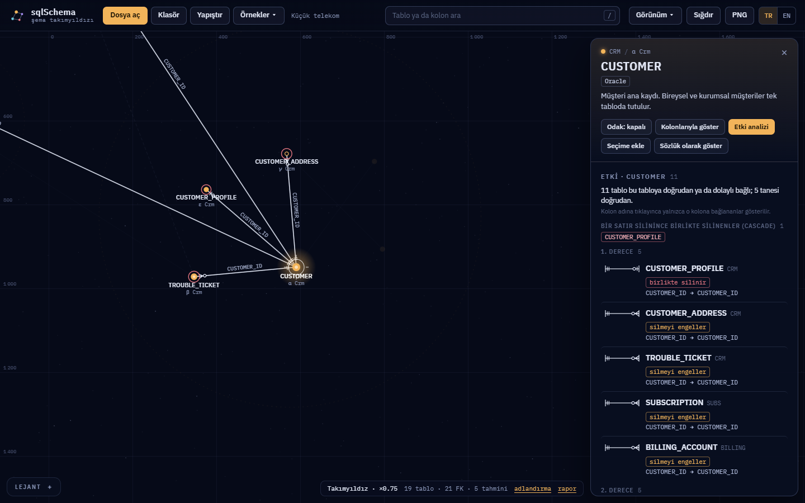

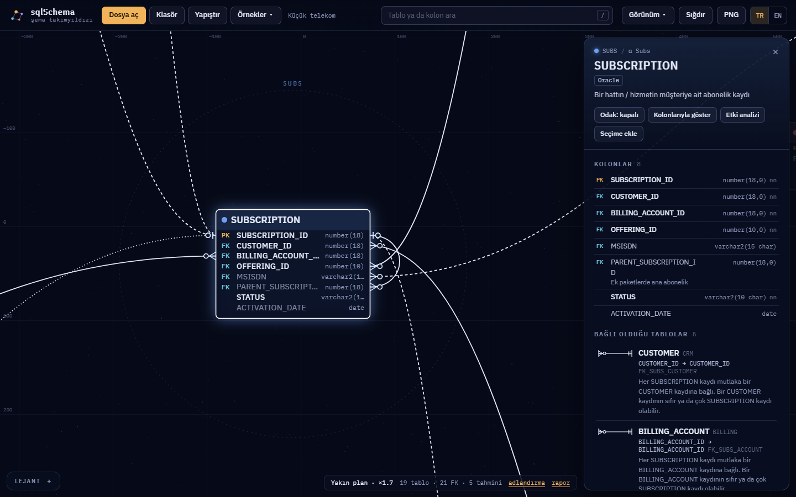

#### Karga ayağı

Çizginin bir ucundaki işaret, o uçtaki tablodan kaç kayıt olabileceğini söyler. Tabloya yakın işaret üst sınırdır, dıştaki alt sınırdır.

| İşaret | Anlamı | Şemadan nasıl çıkarılıyor |
|---|---|---|
| `──‖` | tam olarak bir | FK kolonu `NOT NULL`; gömülü belgenin sahibi |
| `──○┼` | sıfır ya da bir | FK kolonu `NULL` olabilir, ya da FK aynı zamanda PK/UNIQUE (1:1) |
| `──○<` | sıfır ya da çok | FK'yi taşıyan tablonun varsayılanı; ObjectId dizileri |
| `──┼<` | bir ya da çok | DDL ile zorlanamaz (trigger ya da uygulama kuralı gerekir), bu yüzden haritada çıkmaz |

#### Çizgiler, yıldızlar, etiketler

| Çizgi | Anlamı |
|---|---|
| Düz | Tanımlı yabancı anahtar ya da Mongoose `ref` |
| Uzun kesikli | Kolon açıklamasındaki `@ref` etiketiyle tanımlı ilişki (aşağıya bakın) |
| Kesikli | Tahmini ilişki (aşağıya bakın); **Görünüm** menüsünden kapatılabilir |
| Noktalı | Devre dışı FK (`DISABLE`, `RELY DISABLE NOVALIDATE`, T-SQL `NOCHECK`) |
| Kesik-noktalı | MongoDB gömülü belge: alt belge sahibinin içinde yaşar |

| Yıldız | Anlamı |
|---|---|
| Dolu yıldız | Tablo; büyüklük = bağlantı sayısı, renk = şema |
| Halka | Ara tablo (M:N): PK'si iki FK'den oluşur ya da saf bağlantı tablosudur |
| Küçük, soluk yıldız | Uydu: MongoDB gömülü alt belgesi, sahibinin yanında durur |
| Kesikli halka | Bir FK'nin başvurduğu ama dosyalarda tanımı olmayan tablo |

Kartlarda **PK** birincil anahtarı, **FK** yabancı anahtarı, **CK** Cassandra sıralama (clustering) anahtarını gösterir. Soluk kolon adı, kolonun NULL olabileceği anlamına gelir.

**Takımyıldızlar.** Küçük şemalar tek bir takımyıldızdır. Büyük şemalar, tablo adı öneklerine (`CUSTOMER_*`, `INVOICE_*`) ve bağlantılara göre takımyıldızlara bölünür. Her yıldız, takımyıldızındaki parlaklık sırasına göre Bayer usulü bir ad alır (`α Billing`, `β Billing`). Yerleşim deterministiktir: aynı dosyalar her açılışta aynı haritayı verir.

**Tahmini ilişkiler.** Şu iki durumda kesikli çizgiyle çizilir:
- FK tanımlı değil ama kolon adı başka bir tablonun PK'siyle aynı: `CDR.SUBSCRIPTION_ID` → `SUBSCRIPTION.SUBSCRIPTION_ID`.
- `X_ID` / `xId` kolonu, PK'si `ID` ya da `_id` olan X tablosunu gösteriyor: `orders.customerId` → `customers._id`.

Tipler uyuşmuyorsa ya da birden fazla aday varsa çizilmez.

**Açıklamadan ilişki: `@ref`.** Bazı ilişkiler FK ile tanımlanamaz. En sık örnek, genel bir sözlük tablosunun (`SOZLUK`: `ID`, `TIP_ID`, `AD`) yalnızca bir tipine bağlanan kolonlardır. Veritabanı "yalnızca `TIP_ID = 7` olan satırlar" diye bir kısıt koyamaz. Bu ilişkiler kolon açıklamasına yazılan bir etiketle haritaya eklenir:

```sql
COMMENT ON COLUMN ABONE.DURUM_ID IS 'Abone durumu. @ref SOZLUK.ID (TIP_ID = 7)';
COMMENT ON COLUMN SESSION_LOG.USERID IS 'The user ID. @ref USERS';
```

| Yazım | Anlamı |
|---|---|
| `@ref TABLO` | Hedefin birincil anahtarına |
| `@ref TABLO.KOLON` | Hedefin belli bir kolonuna (`TABLO.KOLON` yoksa `ŞEMA.TABLO` sayılır) |
| `@ref ŞEMA.TABLO.KOLON` | Şemayla birlikte |
| `… (KOŞUL)` | Parantez içi koşul çizginin ve panelin üstüne yazılır |

- **Nereden okunur:** etiket açıklamanın herhangi bir yerinde olabilir. Oracle ve PostgreSQL `COMMENT ON COLUMN`, MySQL satır içi `COMMENT '…'` ve SQL Server `sp_addextendedproperty` açıklamaları okunur.
- **Haritada:** bu ilişkiler tahmin değil, DBA'nın beyanıdır; uzun kesikli çizgiyle ve panelde "açıklamadan" etiketiyle gösterilir.
- **FK ile birlikte:** kolonda zaten bir FK varsa yalnızca koşul ona eklenir.
- **Hata:** bulunamayan bir hedef ayrıştırma raporunda uyarı olarak listelenir.

Sigorta örneğinde durum kolonları genel kod tablosuna (`KOD_TABLO`) bu yolla bağlanır.

**Sözlük tabloları.** Genel kod tablosuna yüzlerce kolon bağlandığında çizgiler haritayı boğar ve sözlük dev bir merkez olur. Bu yüzden en az iki **koşullu** ilişkinin hedefi olan tablo sözlük sayılır:
- **Haritada:** ona giden çizgiler çizilmez. Kartta kolonun tipi yerine `→ KOD_TABLO` rozeti görünür. Çizgi yalnızca sözlük ya da bağlanan tablo seçilince ya da üzerine gelinince çizilir.
- **Yerleşimde:** sözlük ilişkileri tabloları birbirine çekmez; sözlük şemanın ortasına oturup öbürlerini sıkıştırmaz.
- **Panelde:** sözlük seçilince **Sözlük kullanımı** bölümü hangi koşulun hangi kolonlarca kullanıldığını listeler (`KOD_TIP = 'POLICE_DURUM'` → `POLICE.POLICE_DURUM`).
- **Elle seçim:** paneldeki **Sözlük olarak göster** / **Sözlük değil** düğmesi otomatik kararı değiştirir; seçim tarayıcıda hatırlanır.
- **Çizgi olarak:** **Görünüm → Sözlük bağlantılarını çiz** ile çizgiler her zaman çizilir.

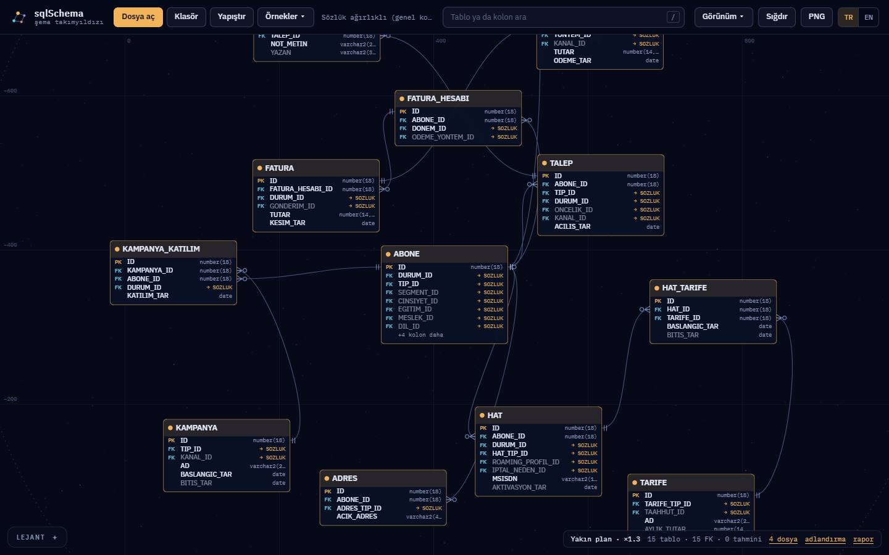

**Sözlük ağırlıklı** örneğinde 30'dan fazla kolon tek bir `SOZLUK` tablosuna bağlıdır.

**Kod değerleri.** Kodların anlamı her zaman ayrı bir tabloda durmaz; çoğu zaman doğrudan kolon açıklamasına yazılır:

```sql
COMMENT ON COLUMN MUSTERI.MUSTERI_TIP IS 'G = Gerçek kişi, T = Tüzel kişi';
COMMENT ON COLUMN HASAR_IHBAR.IHBAR_KANAL IS 'İhbarın geldiği kanal: ACN = Acente, CAG = Çağrı merkezi, WEB = İnternet şubesi';
```

- **Tanınan yazımlar:** `1 = Aktif, 2 = Pasif` · `A: Aktif; P: Pasif` · `E-Evet / H-Hayır` · `Durum (1=Aktif, 2=Pasif)` · `0 => kapalı, 1 => açık`.
- **Yanlış yakalamaya karşı:** en az iki çift, aynı ayraç ve kod gibi görünen kısa kodlar aranır. "Not: eski alan, Kaynak: SAP" ya da "Sürüm 2 = yeni biçim" liste sayılmaz.
- **Panelde:** değerler kolonun altında kutucuk olarak görünür; açıklamanın listede olmayan kısmı ("İhbarın geldiği kanal") ayrı yazılır.
- **Kartta:** kolon adının yanında küçük bir `≡` işareti.
- **Aramada:** değerlerin anlamı da aranır. "iptal" yazınca `4 = İptal` değerini tutan kolon bulunur; büyük/küçük harf ve Türkçe karakter farkı yok sayılır.

İzin verilen değerler başka yerlerde de tanımlı olabilir; hepsi aynı kutucuklarla gösterilir ve kaynağı yanına yazılır:

| Kaynak | Örnek |
|---|---|
| `CHECK` kısıtı | `CHECK (MUSTERI_TIP IN ('G', 'T'))` · SQL Server: `CHECK (([Gender]='F' OR [Gender]='M'))` |
| `ENUM` tipi | MySQL `status enum('active','passive')` |
| MongoDB `enum` | `$jsonSchema` ve Mongoose alanlarındaki `enum: ['tr', 'en']` |

Değerler kısıttan ya da tipten geliyor, anlamları açıklamada yazılıyorsa ikisi birleşir: `CHECK (MUSTERI_TIP IN ('G','T'))` ile `'G = Gerçek kişi, T = Tüzel kişi'` açıklaması `G Gerçek kişi · T Tüzel kişi` olarak görünür. Aralık (`BETWEEN`), karşılaştırma (`> 0`) ve birden fazla kolonlu koşullar değer listesi sayılmaz.

**Sözlük verisi.** Dosyalarda sözlük tablosunun `INSERT` satırları da varsa, `@ref SOZLUK.ID (TIP_ID = 7)` ile bağlı kolonun altında o tipin değerleri görünür (`1 Aktif · 2 Pasif …`; kaynak: "sözlükten: SOZLUK · TIP_ID = 7"):
- **Kod ve anlam:** kod bağlantının hedef kolonundan, anlam `AD`, `ACIKLAMA`, `NAME` gibi bir kolondan alınır.
- **Koşul:** yalnızca `KOLON = değer` eşitlikleri (`AND` ile birden fazla) uygulanır.
- **Koşulsuz sözlük bağlantısı:** değer gösterilmez, çünkü sözlüğün hangi tipinin geçerli olduğu bilinemez. Sözlük olmayan küçük tablolara giden düz FK'lerde tablonun bütün satırları değer olur.
- **Sınır:** yalnızca düz `INSERT … VALUES` okunur, `INSERT … SELECT` okunmaz. Büyük veri dökümlerinde tablo başına ilk 2 000 satır alınır. `INSERT`'ler yine çizime girmez, raporda sayılır.
- **Öncelik:** kolonun kendi `CHECK` ya da açıklama listesi önceliklidir; orada anlamı yazılmamış kodların anlamı sözlükten tamamlanır.

<a id="tr-coklu-dosya"></a>

### Birden fazla dosya ve migration

Dosyalar tek bir modelde birleşir; ad çözümleme en sonda yapılır. Bu yüzden şu durumlar sorun çıkarmaz:
- Bir dosyadaki FK'nin başka bir dosyadaki tabloyu göstermesi.
- `constraints.sql` dosyasının alfabetik sırada `ddl.sql`'den önce gelmesi.

Sağ alttaki **N dosya** bağlantısı dosya listesini açar. Burada:
- Dosyaları tek tek çizime katabilir ya da çıkarabilirsiniz.
- Her dosyanın lehçesini ve kaç tablo içerdiğini görürsünüz.
- "Ayrı veritabanı" seçeneğini açabilirsiniz.

**Dosya başına takımyıldız.** Bir şemanın tabloları birden fazla dosyadan geliyorsa, her dosyanın tabloları kendi takımyıldızında toplanır. Ekipler modülleri çoğunlukla dosyalara ayırdığı için harita da bu ayrımı korur.
- **Ayrı dururlar:** farklı dosyaların takımyıldızları, aralarında ilişki olsa da birbirinden açıkça uzak durur.
- **Sınır ve ad:** her takımyıldız ince bir daireyle sınırlanır ve adı sınırın üstüne yazılır.
- **Ad:** dosya yolundan gelir; aynı adlı dosyalar klasörleriyle ayrılır (`POLICE/tablolar`, `HASAR/tablolar`).

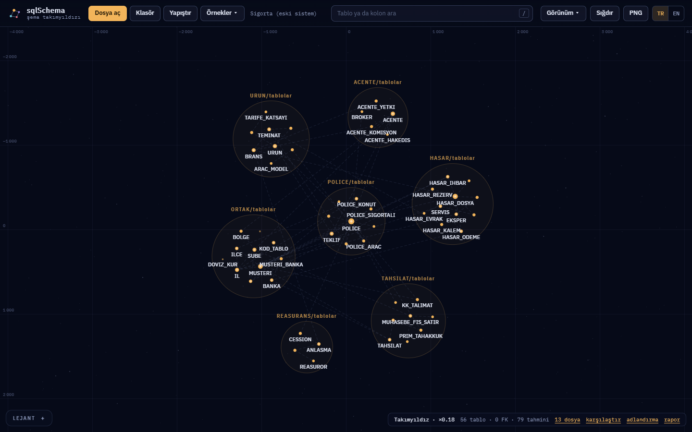

Migration klasörlerinde dosya bir modülü değil bir sürümü gösterir; orada ve MongoDB'de tablolar ad öneki ve ilişkiye göre gruplanır. **Görünüm → Takımyıldızlar** ile seçim elle değiştirilebilir: *Otomatik*, *Dosyaya göre* ya da *Ad ve ilişkiye göre*.

**Okuma sırası** migration araçlarının kurallarını izler:

| Araç | Dosyalar | Davranış |
|---|---|---|
| Flyway | `V1__init.sql`, `V1_1__x.sql`, `V2__y.sql` | Sürüm numarasına göre (V10, V2'den sonra). `R__*.sql` en sonda, `U*__` geri alma betikleri atlanır. |
| golang-migrate, dbmate | `000001_x.up.sql` | `.down.sql` atlanır. |
| Zaman damgalı | `20240115093000_x.sql` | Zaman sırasına göre. |
| Numaralı / diğer | `01_tables.sql`, `a2.sql < a10.sql` | Doğal ad sırası. |

Migration'lar baştan sona uygulanır ve harita şemanın **son hâlini** gösterir. Bunun için şu ifadeler işlenir:
- `RENAME TO`, `RENAME COLUMN`
- `DROP TABLE`, `DROP COLUMN`, `DROP CONSTRAINT`
- `ALTER COLUMN … TYPE`, `MODIFY`, `CHANGE`
- T-SQL `sp_rename`, MySQL `RENAME TABLE`

**Şema farkı.** Alt bilgi çubuğundaki **karşılaştır**, açık dosyaları (sonra) önceki bir sürümle (önce) karşılaştırır:
- **Önceki sürüm:** migration klasöründe bir sürüm seçilir ("V7'ye kadarki hâliyle") ya da önceki sürümün dosyaları / klasörü ayrıca seçilir (ör. prod dökümü ile test dökümü).
- **Haritada:** eklenen tablolar yeşil, silinenler kırmızı, değişenler sarı; adı değişenlerin çevresinde mavi halka var. Değişmeyenler geri planda kalır. Silinen tablolar da haritada yerinde görünür.
- **Panelde:** seçili tablonun farkı: eklenen, silinen ve değişen kolonlar (tip, NULL, PK), adı değişen kolonlar, PK ve FK farkları. Kartta eklenen ve değişen kolon satırları renklenir.
- **Ad değişikliği tahmini:** tablolar kolon kümesinin benzerliğiyle (`customer` → `customers`), kolonlar tip ve ad benzerliğiyle (`weight` → `weight_grams`) eşleştirilir; tahmin olduğu yazılır. Adı değişen kolonun FK'si değişmiş sayılmaz.
- **Rapor:** **Markdown indir** değişiklik listesini sürüm notu ya da inceleme için dosyaya yazar.
- **Bağlantı:** `?diff=V3` migration klasöründe o sürümle karşılaştırmayı açar.

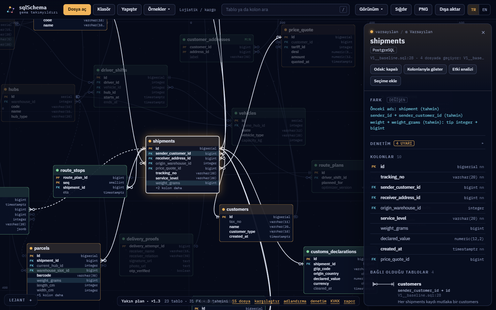

**Zaman çizelgesi.** Migration klasöründe **karşılaştır** penceresindeki **Zaman çizelgesi**, sürümleri sırayla oynatır:
- **Sabit harita:** yerleşim bütün sürümlerdeki tablolardan bir kez kurulur. Adım değişince tablolar yerinde kalır, kamera oynamaz; yalnızca o sürümde var olan tablolar çizilir.
- **Her adım bir fark:** o sürümün bir öncekine göre eklediği, değiştirdiği ve sildiği tablolar şema farkındaki renklerle görünür. **karşılaştır** penceresi o adımın listesini ve Markdown raporunu verir.
- **Gezinme:** kaydırıcı, ‹ › düğmeleri ya da `,` / `.` tuşları; ▶ sürümleri sırayla oynatır.
- **Tablo geçmişi:** seçili tablonun panelinde, oluştuğu, değiştiği ve silindiği sürümler listelenir (`V4__plural_table_names ad: shipment → shipments`). Bir satıra tıklayınca o sürüme gidilir. Adı değişen tablo seçili kalır.
- **Bağlantı:** `?time=V4` çizelgeyi o sürümde açar.

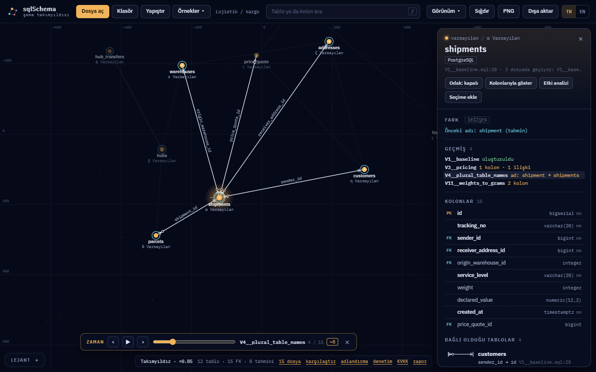

**Ayrı veritabanları.** Farklı lehçelerden dosyalar birlikte açılırsa (örneğin MySQL siparişler, MongoDB katalog, PostgreSQL raporlama) her klasör kendi galaksisi olarak çizilir.

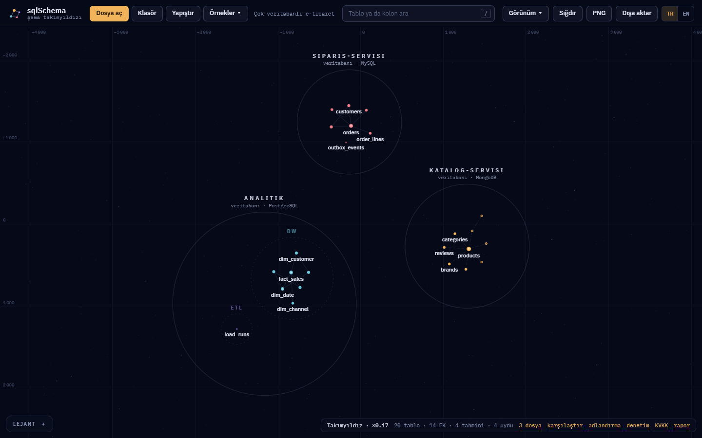

<a id="tr-veritabanlari"></a>

### Desteklenen veritabanları

| | Oracle | SQL Server | MySQL / MariaDB | PostgreSQL | SQLite | Cassandra |
|---|---|---|---|---|---|---|
| `CREATE TABLE`, satır içi ve tablo seviyesi kısıtlar | ✓ | ✓ | ✓ | ✓ | ✓ | ✓ `PRIMARY KEY ((a, b), c)` |
| `ALTER TABLE … ADD CONSTRAINT` | ✓ | ✓ `WITH CHECK/NOCHECK` | ✓ | ✓ `ONLY` | | |
| Kolon değişiklikleri | `MODIFY` | `ALTER COLUMN` | `MODIFY`, `CHANGE` | `ALTER COLUMN … TYPE` | | |
| Yeniden adlandırma, silme | `RENAME`, `DROP` | `sp_rename`, `DROP` | `RENAME TABLE`, `DROP` | `RENAME`, `DROP` | `RENAME`, `DROP` | |
| `CREATE UNIQUE INDEX` (1:1 tespiti) | ✓ | ✓ | ✓ | ✓ | ✓ | |
| Tablo / kolon açıklamaları | `COMMENT ON` | `sp_addextendedproperty` | `COMMENT '…'` | `COMMENT ON` | | |

**Veritabanı türü nasıl anlaşılır.** Seçmeniz gerekmez; her dosyada yalnızca o veritabanına **özgü** ifadeler sayılır ve en çok puan alan seçilir:

| Veritabanı | Bakılan ipuçları |
|---|---|
| Oracle | `VARCHAR2`, `NUMBER(…)`, `TABLESPACE`, `SYSDATE`, `PCTFREE`, `NOVALIDATE`, satırda tek başına `/` |
| SQL Server | `[dbo]`, satırda tek başına `GO`, `NVARCHAR`, `IDENTITY(…)`, `CLUSTERED`, `DATETIME2`, `sp_addextendedproperty` |
| MySQL / MariaDB | `` `ters tırnak` ``, `ENGINE=`, `AUTO_INCREMENT`, `DEFAULT CHARSET`, `UNSIGNED`; MariaDB döküm başlığından |
| PostgreSQL | `SERIAL`, `::tip`, `$$`, `TIMESTAMPTZ`, `JSONB`, `OWNER TO`, `character varying`, `ALTER TABLE ONLY` |
| SQLite | `AUTOINCREMENT`, `WITHOUT ROWID`, `PRAGMA` |
| Cassandra | `.cql` uzantısı, `CREATE KEYSPACE`, `WITH CLUSTERING ORDER`, `frozen<`, `map<` |

`DATE`, `INTEGER`, `VARCHAR` gibi her veritabanında bulunan tipler ayırt etmeye yaramadığı için sayılmaz. İpucu taşımayan sade bir `CREATE TABLE` dosyası, aynı klasördeki dosyaların baskın türünü alır. MongoDB dosyaları uzantıdan ve içerikten (`$jsonSchema`, `new Schema(…)`, JSON belgeleri) tanınır.

**Çizime girmeyenler.** View, sequence, trigger, package, procedure, function, type, grant ve `INSERT` raporda sayılır ama çizilmez (`INSERT … VALUES` satırları yalnızca [sözlük değerleri](#tr-haritayi-okumak) için okunur). Ayrıştırıcı bunların içindeki `;` işaretlerine takılmaz:
- PL/SQL blokları `/` satırına kadar bütün tutulur.
- T-SQL blokları `GO` satırına kadar bütün tutulur.
- MySQL blokları `DELIMITER` ayracına kadar bütün tutulur.

**Sorun çıkarmayanlar:**
- SQL\*Plus komutları
- Oracle depolama ve partition ifadeleri
- PostgreSQL `$$` gövdeleri ve `PARTITION OF` parçaları
- CQL `//` yorumları ve `map<text, int>` tipleri

**Kodlama.** Dosya UTF-8, UTF-16 (SSMS'in varsayılanı) ya da Windows-1254 olabilir; kodlama otomatik seçilir.

<a id="tr-mongodb"></a>

### MongoDB

MongoDB'de DDL yoktur. Şema üç kaynaktan çıkarılır; aynı koleksiyon birden fazla kaynakta geçiyorsa tek tabloda birleşir.

| Kaynak | Örnek | Okunan |
|---|---|---|
| mongosh betikleri (`.js`) | `db.createCollection('x', { validator: { $jsonSchema } })`, `collMod`, `createIndex(…, { unique })` | Alanlar, tipler, zorunlu alanlar, açıklamalar, `enum` değerleri |
| Mongoose modelleri (`.js`, `.ts`) | `new Schema({ author: { type: ObjectId, ref: 'User' } })` | Alanlar ve `ref` ilişkileri. Koleksiyon adları Mongoose'un çoğul kurallarıyla türetilir. |
| Örnek belgeler (`.json`, `.jsonl`, `.ndjson`) | `mongoexport` çıktısı | İlk 5 000 belgeden alan birleşimi; Extended JSON (`$oid`, `$date`) |

Gömülü nesneler ve nesne dizileri, sahibinin yanında duran **uydu** tablolara (`users.profile`, `orders.items`) dönüşür.

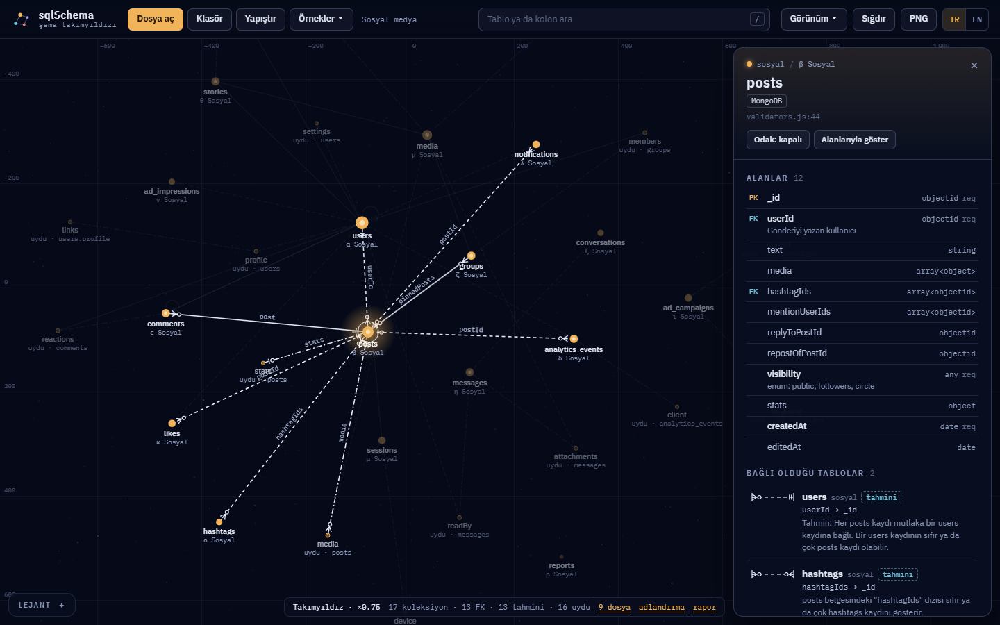

<a id="tr-adlandirma"></a>

### Adlandırma profili

Ekipte yazılı bir adlandırma standardı yoksa ilk adım, şemada fiilen ne kullanıldığını görmektir. Sağ alttaki **adlandırma** bağlantısı adları şu boyutlarda sayar ve oranlarıyla gösterir:

| Boyut | Kalıplar |
|---|---|
| Tablo ve kolon adı harf düzeni | `BÜYÜK_HARF`, `küçük_harf`, `PascalCase`, `camelCase` |
| Birincil anahtar adı | `ID`, `<TABLO>_ID`, `<TABLO>_NO / _KOD`, tablo adıyla ilgisiz |
| Yabancı anahtar kolonu | `<HEDEF>_ID`, `<HEDEF>_NO / _KOD`, rol önekli (`GONDEREN_MUSTERI_ID`, `AGENT_USER_ID → APP_USER`), hedefin PK adıyla aynı, yalnızca rol adı (`SAHIBI`), hedef adını içermeyen (`CHZ_REF`) |
| Tablo adı | tekil / çoğul (tahmini), `TBL_` gibi önekler |
| Karakterler ve uzunluk | Türkçe / ASCII dışı karakter, 30 karakteri aşan adlar |

- Her boyutta **baskın kalıp** ve ona **uymayanlar** listelenir. Listedeki bir ada tıklamak tabloyu seçer.
- En çok kullanılan kalıbın payı %60'ın altındaysa "baskın" denmez; pencere **belirgin baskın kalıp yok** uyarısı gösterir. %51'e %49 gibi bir dağılım, şemada iki ayrı alışkanlık olduğunu söyler.
- **Kapsam** seçimiyle profil tek bir şema için hesaplanır. Böylece hangi modülün hangi alışkanlıkla yazıldığı ayrılır.
- **Tutarlılık** puanı, her boyutta baskın kalıba uyan adların ortalama oranıdır.
- **Markdown indir** profili ekiple paylaşmak için bir dosyaya yazar.

Araç bir kural dayatmaz: `ID` mi `<TABLO>_ID` mi doğru, buna ekip karar verir.

**Orana katılmayanlar:**
- Bileşik PK'ler, PK'si üst tablodan gelen 1:1 tablolar ve PK'siz tablolar. Bunlar ayrıca gösterilir.
- `CREATED_BY`, `UPDATED_BY`, `GUNCELLEYEN`, `KAYIT_KULLANICI` gibi denetim kolonları. Kullanıcı tablosuna bağlı olsalar da kendi yerleşik kalıpları vardır; ayrıca sayılırlar.
- Tahmini ilişkiler: zaten ada dayandıkları için yalnızca tanımlı FK'ler sayılır.
- MongoDB koleksiyonlarının `_id` ve `ref` alanları.

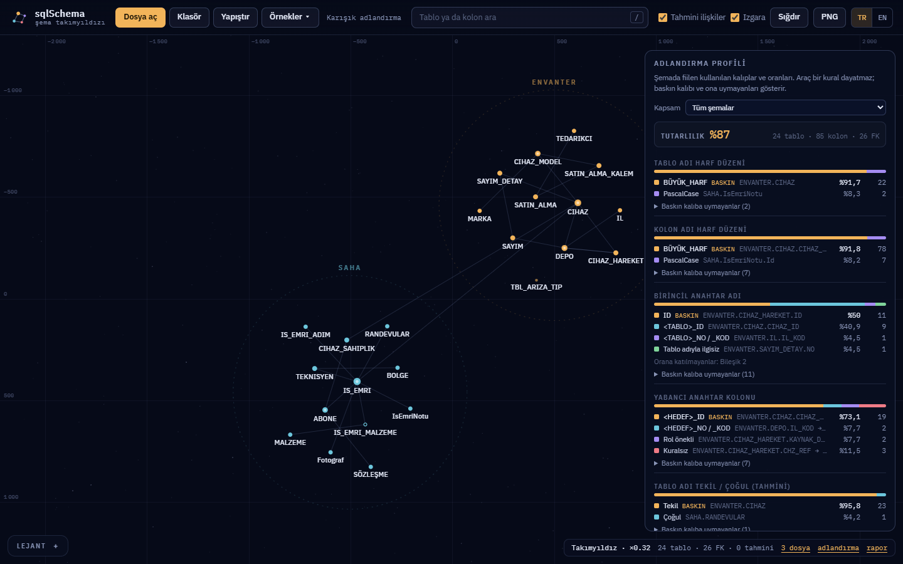

**Karışık adlandırma** örneği bu özellik için hazırlanmıştır: iki ekibin farklı alışkanlıklarla tablo eklediği bir Oracle şeması.

<a id="tr-denetim"></a>

### Tasarım denetimi

Sağ alttaki **denetim** bağlantısı şemayı yaygın tasarım hatalarına karşı tarar. Her bulgu üç şey söyler:
- **Ne:** "`BASLANGIC_TAR` kolonu `VARCHAR2(20)`"
- **Neden sorun:** tarih metin olunca aralık sorguları indeks kullanamaz, sıralama yanlış olur
- **Öneri:** `DATE` ya da `TIMESTAMP` kullanın

Kurallar dört grupta toplanır:

| Grup | Örnek kurallar |
|---|---|
| Anahtarlar ve bütünlük | PK'siz tablo, FK ile hedef kolonun tipi uyuşmuyor, tanımlanmamış ilişki, indeksi olmayan FK, döngüsel FK zinciri, gereksiz indeks, devre dışı FK, bulunamayan `@ref` hedefi |
| Veri tipleri | metin tarih, metin sayı, `FLOAT` tutar, gereğinden geniş metin, değişken veri için `CHAR`, kısa metin için `CLOB`, aynı adlı kolonların farklı tipi, farklı biçimlerde mantıksal kolonlar (E/H, Y/N, 0/1) |
| Normalizasyon | `TEL1, TEL2, TEL3` gibi tekrarlayan kolonlar, virgülle ayrılmış liste, anahtar-değer (EAV) tablosu, çok kolonlu tablo |
| Adlandırma | ad sınırını aşan ad (Oracle 12.1 ve öncesinde 30), ayrılmış kelime, Türkçe karakter, `SYS_C0012345` gibi sistem adları; PK, FK ve harf düzeninde baskın kalıba uymayanlar |

- **Önem:** hata, uyarı ve bilgi. Addan tahmin yürüten kurallar (metin tarih, tutar, EAV ...) **addan tahmin** olarak işaretlenir.
- **Yanlış alarmı azaltmak için:**
  - Kayıt, geçmiş ve olgu tablolarında (`_LOG`, `_HIST`, `_CDR`, `FACT_`) PK ve FK yokluğu bilinçli sayılır.
  - SQLite'ta metin tarih olağandır.
  - Rol adlı FK'ler (`FATURA_ADRES_ID`) ve metin tipli doğal anahtarlar (`PARA_BIRIMI_KOD`) kalıp dışı sayılmaz.
  - Dosyalarda hiç indeks tanımı yoksa FK indeksi denetlenmez.
- **Haritada göster:** hatalı tablolar kırmızı, uyarılılar sarı; öbürleri geri planda kalır. Kartta bulgusu olan kolon satırları renklenir.
- **Panelde:** seçili tablonun bulguları ve önerileri **Denetim** bölümündedir.
- **Pencerede:** en çok bulgu olan on tablo listelenir. **Markdown indir** bütün bulguları neden ve öneriyle bir inceleme belgesine yazar.
- **Zaman çizelgesiyle:** her sürümde denetim yeniden hesaplanır; bir bulgunun hangi migration'la geldiği görünür.
- **Bağlantı:** `?audit=1` denetimi haritada açar, `?pop=audit` pencereyi açar.

**Borç kaydı: geçmişi affet, geleceği denetle.** Dağınık bir veritabanında ilk denetim yüzlerce bulgu çıkarır; yüzlerce eski tabloyu bir anda düzeltmek de gerçekçi değildir.
- **Kabul etmek:** pencerede **Mevcut bulguları borç olarak kabul et** o anki bulguları kaydeder. Kayıttaki bulgular ayrı bir **Kabul edilmiş borç** listesinde durur, hata sayılmaz ve haritada renk almaz. Bundan sonra yalnızca yeni bulgular öne çıkar: yeni bir migration'ın getirdiği PK'siz tablo hemen görünür.
- **İlerleme:** düzeltilen bulgular **ödenen borç** olarak sayılır; çubuk borcun ne kadarının ödendiğini gösterir.
- **Ekiple paylaşmak:** **Proje dosyasını indir** borç kaydını (ve kayıtlı görünümleri) `<ad>.sqlschema.json` dosyasına yazar. Dosyayı şema klasörüne koyup depoya ekleyin: klasörü açan herkes aynı borcu görür. Dosya şemayı içermez.
- **Saklama:** kayıt tarayıcıda proje adına göre de tutulur; yeni migration eklenince kaybolmaz. Klasördeki dosya ile tarayıcıdaki kayıttan daha yeni olanı geçerlidir.
- **Kimlik:** bir bulgu kural, tablo ve kolon adıyla eşleşir. Tablonun adı değişirse bulgu yeni sayılır.

**Düzeltme önerileri.** Pencerede **Düzeltme betiği** düzeltilebilen bulgular için lehçeye uygun SQL üretir (Oracle, PostgreSQL, SQL Server, MySQL / MariaDB, SQLite):
- **Ne üretilir:**
  - eksik FK ve FK indeksi; Oracle'da `ENABLE NOVALIDATE`, PostgreSQL'de `NOT VALID`, SQL Server'da `WITH NOCHECK` seçeneğiyle
  - devre dışı FK'yi açma (önce yetim kayıtları bulan sorgu)
  - gereksiz indeksi kaldırma
  - PK ekleme (kolon adı şemanın baskın PK adlandırmasını izler)
  - FK kolonunu genişletme
  - metin tarih, metin sayı, `FLOAT` tutar ve `CLOB` dönüşümü: yeni kolon, kopyalama, doğrulama, eski kolonu kaldırma, yeniden adlandırma
  - sistem adlı kısıtları ve Türkçe karakterli, harf düzeni farklı ya da belirsiz adlı kolonları yeniden adlandırma
- **Risk:** her öneri **güvenli** (indeks, FK, kısıt adı), **gözden geçirin** (PK ekleme, indeks kaldırma, tip genişletme) ya da **riskli** (veri dönüşümü, ad değişikliği) olarak işaretlenir. Riskliler varsayılan olarak betiğe girmez.
- **Notlar:** her adımın üstünde açıklama vardır ("tarih biçimini verinize göre değiştirin", "bu adı kullanan uygulama kodu da güncellenmeli"). Veri temizlendikten sonra çalıştırılacak doğrulama adımları yorum olarak yazılır. Tablo adını değiştiren adımlar en sondadır.
- **Elle düzeltilenler:** döngü, EAV, tekrarlayan kolonlar ya da yeni bir ad seçmeyi gerektiren bulgular için SQL üretilmez; tasarım kararı gerektirir.
- **Kullanım:** borç kaydı varsa yalnızca yeni bulgular için üretilir. Betik kopyalanır ya da `.sql` olarak indirilir. Panelde her bulgunun altında kendi SQL'i de görünür.
- **Sınama:** testler üretilen betiği örneklere yeni bir migration olarak ekleyip yeniden denetler; düzeltilen bulguların kaybolduğunu ve yeni bulgu çıkmadığını doğrular.

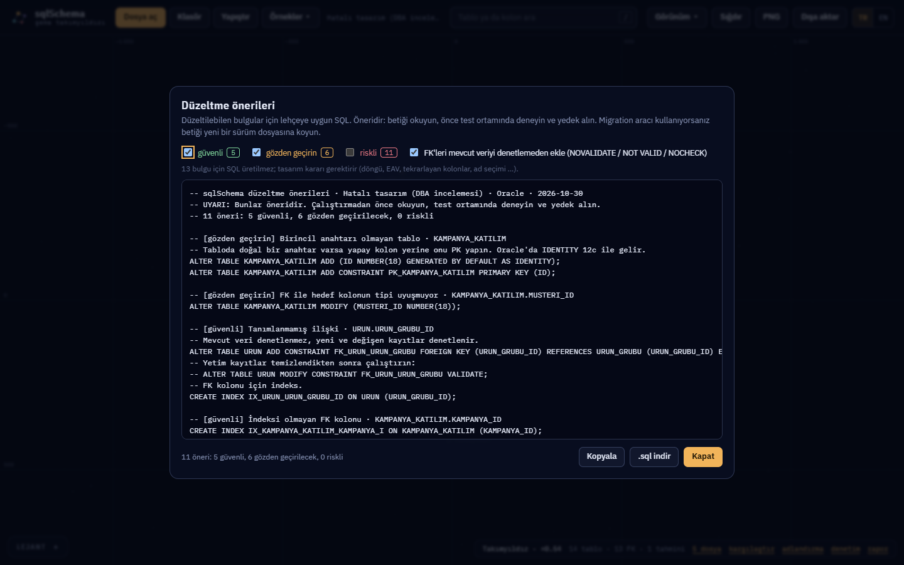

**Değişiklik incelemesi (PR).** Hatayı canlıya çıkmadan, yeni migration'ın PR'ında yakalamak için:
- **Açmak:** bir karşılaştırma (önce → sonra) ya da zaman çizelgesi açıkken **karşılaştır** penceresindeki **İnceleme raporu**. Denetim penceresinin başında da bu değişikliğin özeti görünür.
- **Ne sayılır:** "sonra"da olup "önce"de olmayan bulgular bu değişiklikle gelmiştir; tersi giderilmiştir. Adı değişen tablolar eşlenir: eski bulgu yeni adıyla "yeni" görünmez. Borç kaydındakiler sayılmaz. Önce denetlenemeyen bir kural (dökümde indeks yoktu) sonra çalışırsa değişmeyen tablolardaki bulguları yeni sayılmaz.
- **Rapor:** PR yorumuna yapıştırılacak Markdown. Eklenen, değişen ve silinen tablo sayıları; önem sırasıyla yeni bulgular; giderilenler. İsteğe bağlı olarak güvenli ve gözden geçirilecek düzeltme SQL'i katlanır bir bölümde.
- **Bağlantı:** `?diff=V14&review=1` raporu açar.

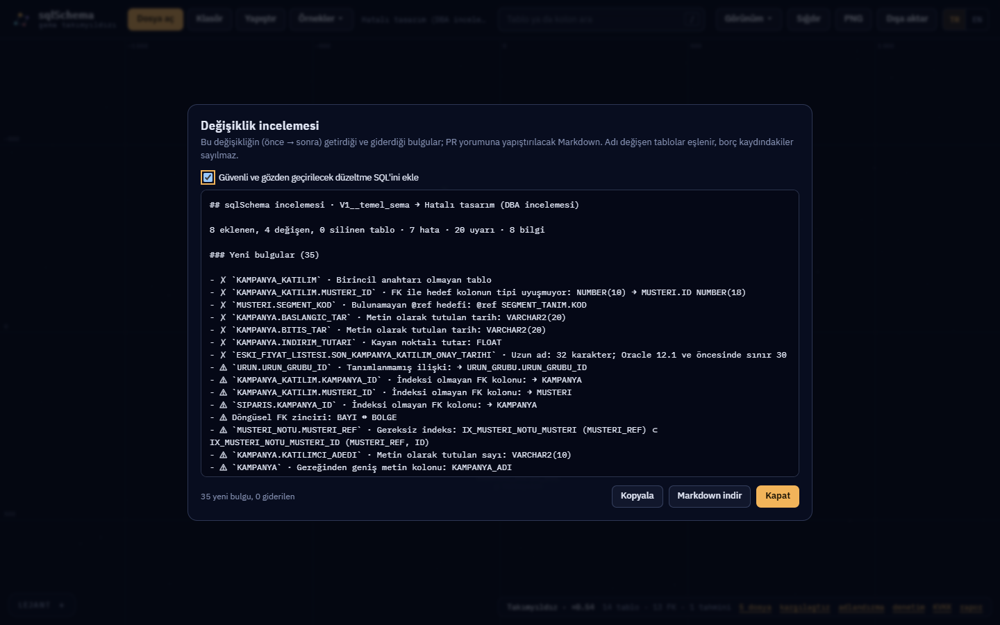

**Komut satırı ve CI.** Aynı denetim, borç kaydı ve değişiklik incelemesi tarayıcı olmadan da çalışır; böylece PR'lar elle incelenmeden atlanmaz:

```bash
node tools/sqlschema-lint.js db/migration --since V15 --format md --fail-on error
```

| Seçenek | Görevi |
|---|---|
| `<dosya\|klasör>...` | denetlenecek şema; klasörler özyinelemeli taranır |
| `--since V15` | migration klasöründe V15 ve sonrasını incele (önce = V15'ten öncekiler) |
| `--baseline <yol>` | bu kopyayla karşılaştırarak incele (ör. ana dalın şeması) |
| `--project <dosya>` | borç kaydı; verilmezse klasördeki `*.sqlschema.json` okunur |
| `--format text\|md\|json\|sarif` | metin, PR yorumu için Markdown, JSON ya da GitHub kod taraması için SARIF |
| `--fail-on error\|warning\|info\|none` | bu önemde yeni bulgu varsa çıkış kodu 1 (varsayılan `error`) |
| `--fix <dosya>` | güvenli ve gözden geçirilecek düzeltme SQL'ini dosyaya yaz |
| `--out <dosya>`, `--lang tr\|en`, `--separate` | çıktı dosyası, dil, klasörleri ayrı veritabanı sayma |

- Çıkış kodu: 0 eşiğin altında, 1 eşikte ya da üstünde yeni bulgu, 2 kullanım hatası ya da şema bulunamadı.
- Borç kaydındaki bulgular ve (inceleme kipinde) değişiklikten önce de var olan bulgular eşiğe sayılmaz.
- Node 18+ yeterlidir; bağımlılık yoktur. Dosyalar yalnızca okunur, ağ isteği yapılmaz; şema ekibin makinesinden ya da CI sunucusundan çıkmaz.

GitHub Actions örneği: PR'ın getirdiği bulguları yorum olarak yazar, hata varsa kontrolü kırar ve SARIF'i kod taramasına yükler. GitLab CI ve Jenkins'te aynı komut çalışır.

```yaml
name: sqlSchema
on: pull_request
permissions: { contents: read, pull-requests: write, security-events: write }
jobs:
  schema-review:
    runs-on: ubuntu-latest
    steps:
      - uses: actions/checkout@v4
        with: { fetch-depth: 0 }
      - uses: actions/setup-node@v4
        with: { node-version: 20 }
      # bir sürüm etiketine sabitleyin
      - run: git clone --depth 1 --branch main https://github.com/umitkrkmz/sqlSchema.git ../sqlschema
      - run: git worktree add ../base origin/${{ github.base_ref }}
      - run: node ../sqlschema/tools/sqlschema-lint.js db/migration --baseline ../base/db/migration --format md --out review.md --fail-on error
      - if: always()
        run: gh pr comment ${{ github.event.pull_request.number }} --body-file review.md
        env: { GH_TOKEN: ${{ github.token }} }
      - if: always()
        run: node ../sqlschema/tools/sqlschema-lint.js db/migration --baseline ../base/db/migration --format sarif --out sqlschema.sarif --fail-on none
      - if: always()
        uses: github/codeql-action/upload-sarif@v3
        with: { sarif_file: sqlschema.sarif }
```

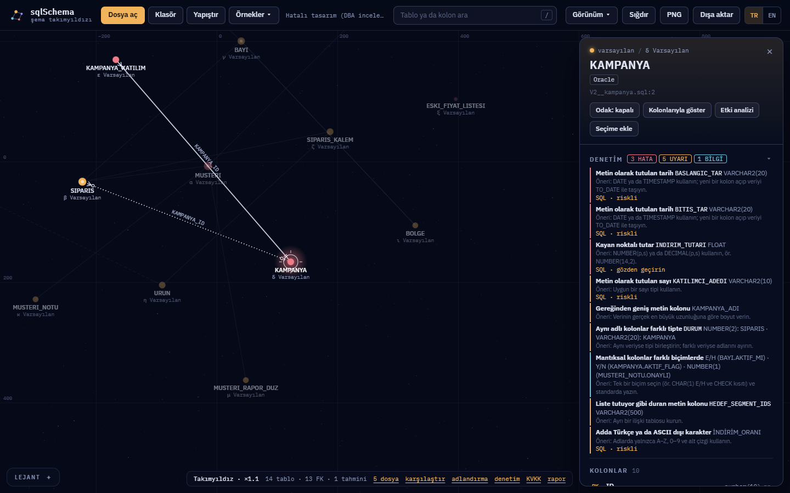

**Hatalı tasarım (DBA incelemesi)** örneği bu özellik için hazırlanmıştır: düzgün bir başlangıç şemasına üç geliştiricinin özensiz eklediği migration'lar. Her kural en az bir kez tetiklenir.

<a id="tr-ornekler"></a>

### Örnekler

`samples/` altındaki örnekler **sentetiktir**: gerçek bir kuruma ait değildir. Her biri bir sektörün tipik yapısını ve bir aracın gerçek dışa aktarım biçimini taklit eder. **Örnekler** menüsünden açılırlar.

| Örnek | Veritabanı | Senaryo |
|---|---|---|
| Küçük telekom | Oracle | 20 tablo, uygulamaya gömülü |
| Telekom BSS/OSS | Oracle | SQL Developer dökümü tek dosyada: 318 tablo, 16 şema, partition, trigger, paket |
| Telekom, şema başına dosya | Oracle | Aynı şema 16 dosyaya bölünmüş; bütün FK'ler en sondaki dosyada |
| Çekirdek bankacılık | SQL Server | SSMS "Generate Scripts": UTF-16, `GO`, `IDENTITY`, açıklamalar |
| Sigorta (eski sistem) | Oracle | Modül başına klasör, Türkçe adlar, hiç FK yok |
| Pazaryeri e-ticaret | MySQL | `mysqldump --no-data`, `DELIMITER`'lı yordam |
| Hastane bilgi sistemi | PostgreSQL | OMOP CDM biçimi: tablolar, PK, FK, indeks ve açıklamalar ayrı dosyalarda |
| Lojistik / kargo | PostgreSQL | Flyway, 14 sürüm: adı değişen ve silinen tablolar, partition |
| IoT telemetri | Cassandra | İki keyspace, sorgu başına tablo |
| Sosyal medya | MongoDB | `$jsonSchema` + Mongoose + `mongoexport` |
| Saha servisi mobil uygulaması | SQLite | `sqlite3 .dump`, çevrimdışı önbellek |
| Çok veritabanlı e-ticaret | MySQL + MongoDB + PostgreSQL | Mikroservisler, her klasör ayrı galaksi |
| Karışık adlandırma | Oracle | İki ekip, iki alışkanlık: PK `ID` ve `<TABLO>_ID`, kuralsız FK'ler, ORM tabloları |
| Sözlük ağırlıklı | Oracle | Bütün kodlar tek bir `SOZLUK` tablosunda; 30'dan fazla kolon ona `@ref` ile bağlı |
| Hatalı tasarım (DBA incelemesi) | Oracle | Düzgün bir şemaya özensiz eklenmiş migration'lar; her denetim kuralı tetiklenir |

<a id="tr-disa-aktarma"></a>

### Şemayı dışa aktarmak

| Veritabanı | Nasıl |
|---|---|
| Oracle, SQL Developer | *Araçlar → Veritabanı Dışa Aktarma*, yalnızca DDL. "Nesne türüne göre ayrı dosyalar" çıktısı klasör olarak açılabilir. |
| Oracle, SQL\*Plus / SQLcl | Aşağıdaki `DBMS_METADATA` betiği |
| SQL Server | SSMS → veritabanı → *Tasks → Generate Scripts* (yalnızca şema) |
| MySQL / MariaDB | `mysqldump --no-data veritabani > sema.sql` |
| PostgreSQL | `pg_dump --schema-only veritabani > sema.sql` |
| SQLite | `sqlite3 app.db .schema > sema.sql` |
| Cassandra | `cqlsh -e "DESCRIBE KEYSPACE telemetry" > sema.cql` |
| MongoDB | Doğrulayıcı betikleri, Mongoose model klasörü ya da `mongoexport --limit 1000` çıktıları |

Migration kullanan projelerde `db/migration` klasörünü olduğu gibi açmanız yeterlidir.

```sql
-- Oracle: veri sözlüğünden DDL ve açıklamalar
SET LONG 20000000 LONGCHUNKSIZE 20000000 PAGESIZE 0 LINESIZE 32767 TRIMSPOOL ON FEEDBACK OFF
EXEC DBMS_METADATA.SET_TRANSFORM_PARAM(DBMS_METADATA.SESSION_TRANSFORM, 'SQLTERMINATOR', TRUE);
EXEC DBMS_METADATA.SET_TRANSFORM_PARAM(DBMS_METADATA.SESSION_TRANSFORM, 'SEGMENT_ATTRIBUTES', FALSE);
SPOOL sema.sql
SELECT DBMS_METADATA.GET_DDL('TABLE', table_name, owner) FROM all_tables WHERE owner IN ('CRM', 'BILLING');
SELECT DBMS_METADATA.GET_DEPENDENT_DDL('COMMENT', table_name, owner) FROM all_tables t
 WHERE owner IN ('CRM', 'BILLING')
   AND (EXISTS (SELECT 1 FROM all_tab_comments c WHERE c.owner = t.owner AND c.table_name = t.table_name AND c.comments IS NOT NULL)
     OR EXISTS (SELECT 1 FROM all_col_comments c WHERE c.owner = t.owner AND c.table_name = t.table_name AND c.comments IS NOT NULL));
SPOOL OFF
```

<a id="tr-dil"></a>

### Dil

Arayüz Türkçe ve İngilizcedir. İlk açılışta sistem dili Türkçe ise Türkçe, değilse İngilizce seçilir. Sağ üstteki **TR / EN** düğmeleriyle değiştirilebilir; seçim tarayıcıda hatırlanır. Bir bağlantıda dili sabitlemek için `?lang=tr` ya da `?lang=en` kullanılabilir.

**Paylaşılabilir bağlantılar.** URL parametreleriyle bir örnek, bir tablo ve yakınlaştırma düzeyi doğrudan açılabilir:

```
index.html?lang=tr&sample=telekom&select=BILLING_ACCOUNT&zoom=0.9&legend=0
```

Açılışta bir pencere göstermek için `pop=naming`, `pop=report` ya da `pop=files` eklenir. `center=TABLO` bir tabloyu seçmeden ortalar.

<a id="tr-gelistirme"></a>

### Proje yapısı ve geliştirme

```
index.html          sayfa iskeleti, lejant
style.css           görünüm
js/                 tarayıcıda bu sırayla yüklenir; hepsi globalThis.sqlSchema ad alanına ekler
  i18n.js           Türkçe / İngilizce sözlükler, dil seçimi
  lexer.js          tokenizer, ifade ayırıcı, lehçe tahmini
  sql-parser.js     DDL → sıralı işlem listesi (create, fk, rename, drop ...)
  mongo.js          $jsonSchema, Mongoose ve JSON belgelerinden aynı işlem listesi
  files.js          dosya sıralama (Flyway, golang-migrate), ayrıştırıcı seçimi
  model.js          işlemleri uygular: tablolar, ilişkiler, kardinalite, ara tablo, tahmini ilişki
  diff.js           iki modelin farkı: tablo, kolon, PK, FK; ad değişikliği tahmini; zaman çizelgesi
  layout.js         veritabanı → şema → takımyıldız → yıldız, hiyerarşik kuvvet yerleşimi
  conventions.js    adlandırma profili: kalıplar, oranlar, baskın kalıba uymayanlar
  audit.js          tasarım denetimi: kurallar, bulgular (kod döner, metin arayüzde)
  fixes.js          düzeltme önerileri: lehçeye uygun SQL, risk düzeyi
  sample-small.js   gömülü küçük örnek
  render.js         canvas çizimi, kamera, karga ayağı
  ui.js             yükleme, dosya listesi, arama, panel, rapor, URL parametreleri
samples/            sentetik örnekler ve catalog.js (üretilir)
tools/              örnek ve ekran görüntüsü üreticileri, sektör tanımları
tests/run.js        bütün örnekleri, ayrıştırıcı kenar durumlarını ve çevirileri denetler
docs/images/        README görüntüleri (tr/ ve en/)
```

Geliştirme komutları (Node 18+, bağımlılık yok):

```bash
node tests/run.js                                  # testler
node tools/gen-samples.js                          # samples/ klasörünü yeniden üretir
node tools/screenshots.js http://localhost:8000/   # README görüntülerini yeniler (Chrome gerekir)
```

Ayrıştırıcı, model, yerleşim ve adlandırma profili DOM'a dokunmaz; Node'da `require` edilebilir. Konsoldan inceleme için `window.sqlSchema` açıktır:

```js
sqlSchema.S.model.tables.filter(t => t.junction).map(t => t.name)
sqlSchema.loadText('CREATE TABLE a (id int PRIMARY KEY);', 'deneme.sql')
```

<a id="tr-sinirlar"></a>

### Sınırlar

- View'lar ve view'lar üzerinden kurulan ilişkiler çizilmez.
- Tahmini ilişkiler yalnızca kolon adlarına dayanır; adlandırma kuralı tutarsız şemalarda eksik ya da fazla çıkabilir. MongoDB'de `authorId` gibi koleksiyon adıyla eşleşmeyen alanlar bağlanmaz.
- `CREATE TABLE … AS SELECT` tabloları kolonsuz görünür.
- MongoDB şeması örnek belgelerden çıkarılıyorsa yalnızca o belgelerde görülen alanlar listelenir.
- Değişkenle kurulan dinamik Mongoose şemaları (`new Schema(buildFields())`) okunmaz.

<a id="tr-katki"></a>

### Katkı, güvenlik, lisans

- Katkı rehberi: [CONTRIBUTING.md](CONTRIBUTING.md)
- Davranış kuralları: [CODE_OF_CONDUCT.md](CODE_OF_CONDUCT.md)
- Güvenlik açığı bildirimi: [SECURITY.md](SECURITY.md)
- Değişiklik geçmişi: [CHANGELOG.md](CHANGELOG.md)
- Yapay zekâ kodlama ajanları için proje rehberi: [AGENTS.md](AGENTS.md)

Lütfen hata bildirirken gerçek bir kuruma ait şema paylaşmayın; tablo adlarını değiştirmek yeterlidir.

[MIT](LICENSE) lisansı ile dağıtılır.

<p align="right"><a href="#tr">↑ başa dön</a></p>

---

<a id="en"></a>

## English

sqlSchema reads database schema files in the browser and draws them as a star map:
- Every table is a star.
- Every relationship is a line between two stars.
- Every schema is a region of sky, and every database is a galaxy.

Zoom in and the stars turn into table cards with columns, and relationships read in crow's foot notation.

It is less manual than draw.io and lighter than a data-modelling tool. The goal is that someone seeing a schema for the first time can answer "what is connected to what?" in seconds.

### Contents

1. [Highlights](#en-highlights)
2. [Quick start](#en-quick-start)
3. [Reading the map](#en-reading)
4. [Multiple files and migrations](#en-multi-file)
5. [Supported databases](#en-databases)
6. [MongoDB](#en-mongodb)
7. [Naming profile](#en-naming)
8. [Design audit](#en-audit)
9. [Samples](#en-samples)
10. [Exporting a schema](#en-export)
11. [Language](#en-language)
12. [Project layout and development](#en-development)
13. [Limitations](#en-limitations)
14. [Contributing, security, license](#en-contributing)

<a id="en-highlights"></a>

### Highlights

- **Plain HTML, CSS and JavaScript.** No dependencies, no build step; just open the folder.
- **Privacy:** files never leave the browser and are not sent to any server.
- **Eight databases:** Oracle, SQL Server, MySQL, MariaDB, PostgreSQL, SQLite, Cassandra and MongoDB.
- **One file, many files or a whole folder:** split dumps, migration folders (Flyway, golang-migrate), multi-database projects.
- **Crow's foot notation:** cardinality is derived from `NOT NULL`, `UNIQUE` and primary keys.
- **Inferred relationships:** links are found from column names in legacy systems without FKs, in Cassandra and in MongoDB.
- **Naming profile:** shows which naming patterns the schema uses, in what proportion, and which tables depart from the dominant pattern.
- **Design audit:** lists mistakes such as tables without a PK, text dates and unindexed FKs, with reasons and suggestions.
- **Schema diff and timeline:** compares two versions and plays migrations in order.
- **Scale:** a 4.7 MB dump with 2,862 tables opens in about 0.6 s, and a frame draws in under 10 ms.
- **Turkish and English interface.**

<a id="en-quick-start"></a>

### Quick start

1. Download or clone the repository.
2. Open `index.html` in a browser.
3. Drag your schema files or a folder onto the page. Alternatively use **Open files** (multiple selection allowed), **Folder**, **Paste** or **Samples**.

The browser can read the sample files and dropped folders only when the page is served. Run this in the project folder and open `http://localhost:8000`:

```bash
python -m http.server 8000
```

> The app also works when `index.html` is opened directly from disk (`file://`). In that case choose folders with the **Folder** button instead of dragging them. The embedded small sample always opens.

| Gesture | Result |
|---|---|
| Wheel / pinch | Zoom |
| Drag | Pan |
| Click | Select a table, open the detail panel |
| Double-click | Zoom into a table, show its columns |
| `/` | Search tables or columns |
| `F` | Fit everything |
| `C` | Hide / show column details |
| `L` | Open / close the table list |
| `↑` / `↓`, `Enter` | Move through the panel's relationships, go to the chosen table |
| `Alt` + `←` / `→` | Back / forward in the navigation history |
| `,` / `.` | Previous / next version on the timeline |
| `Esc` | Leave focus mode / clear the selection |

<a id="en-reading"></a>

### Reading the map

The view changes with the zoom level:

| View | What you see |
|---|---|
| Galaxy | Databases, schemas and bundles of relationships between schemas (the number on a line = relationship count) |
| Constellation | Tables become stars: size = number of links, colour = schema. The lines of the selected table show crow's feet and column names. |
| Close-up | Tables become cards; lines attach directly to the FK and PK column rows. |

The **View** menu holds the table list, column details, inferred relations, lookup links, grid and constellation grouping options. With **column details** off (shortcut `C`), close-up cards show only the table name and lines attach to the card header, leaving just tables and their relationships. The detail panel still lists the columns. The choice is remembered in the browser.

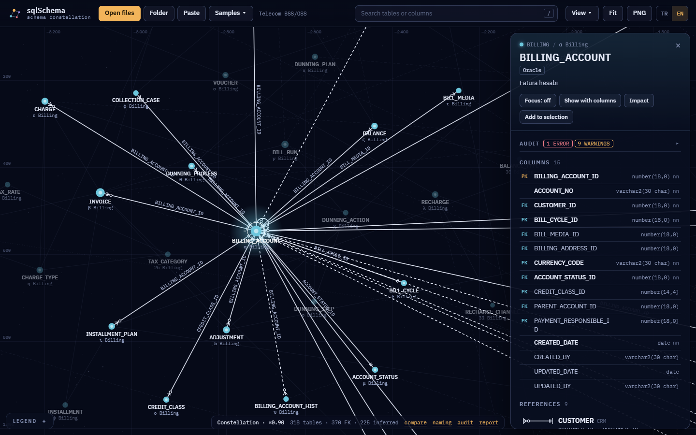

The detail panel lists:
- the columns and their comments
- the file and line where the table is defined
- a plain-language reading of every relationship, such as *"Every INVOICE record belongs to exactly one BILLING_ACCOUNT record. A BILLING_ACCOUNT record can have zero or many INVOICE records."*

**Focus mode** keeps only the neighbours one or two steps away from the selected table and dims everything else.

**Following relationships.** Clicking a relationship in the panel (or picking it with `↓` and pressing `Enter`) goes to that table. The **trail** at the top of the panel lists the tables visited in order (`ABONE › IS_EMRI › CIHAZ`); click a name in it, the `‹ ›` buttons, or press `Alt` + `←` / `→` to go back and forward. The whole schema can be walked without touching the mouse.

**Table list.** Lists every table under schema and constellation headings (**View → Table list** or `L`; off by default):
- **Order:** tables are listed in the order they are defined in the SQL files (**File order**) or by name (**A → Z**).
- **Navigation:** `↑` / `↓` moves from table to table; the selection, the panel and the map move together. Press `↓` in the filter box to step into the list.
- **Filter:** the box at the top filters only the list, not the map.
- **Marks:** each row shows the column count; tables without a PK, junction (M:N), lookup and external tables carry small tags.
- The list and the legend share the same edge; opening one closes the other. The choice is remembered in the browser.

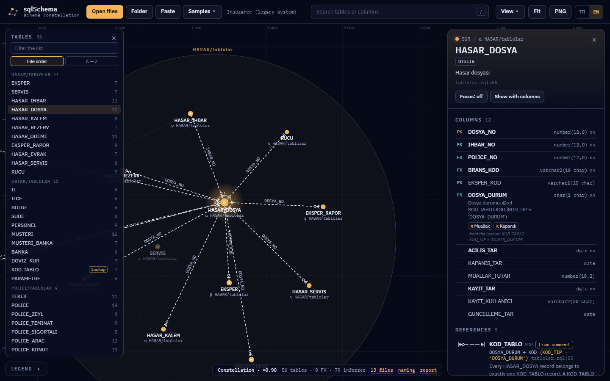

**Sub-diagram.** To see only the tables you care about in a large schema, on a map of their own:
- **Picking:** `Ctrl` / `Cmd` + click on the map, the **Add to selection** button in the panel, or `Ctrl` / `Cmd` + click in the table list. The **+** on a constellation heading in the list adds the whole constellation (for example one module file). Picked tables are marked with a highlighted ring.
- **Opening:** **Open sub-diagram** in the bar that appears at the top. With **with neighbours** ticked, tables directly linked to the picked ones come along.
- **In the sub-diagram:** only these tables and the relationships between them are drawn, with a layout of their own; the panel, search, table list and naming profile also look only at these tables.
- **Going back:** **Back to all** or `Esc`. The full map returns with the same positions.
- **Link:** `?sub=BILLING_ACCOUNT,INVOICE&near=1` opens this sub-diagram directly.
- **Saved views:** while in a sub-diagram, **Save** gives it a name. Views are kept in the browser per set of opened files; when the same files are opened again they are listed under **View → Saved views**. **Export** writes them to a `.sqlschema.json` file and **Import** reads it back. The file carries only the view (table names), not the schema, so it is safe to share within a team.

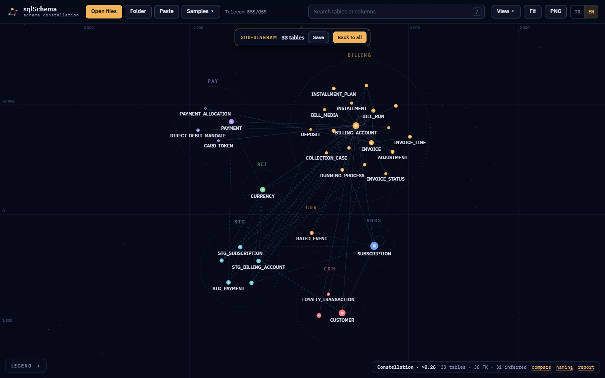

**Impact analysis.** "What is affected if I change this table or delete one of its rows?" Opened with the **Impact** button in the panel:
- **Affected tables:** every table that points to it is listed level by level (level 1 points directly, level 2 points to those …). On the map unaffected tables fade and affected ones get a ring coloured by level.
- **What happens on delete:** each link says whether rows are **deleted too** (`ON DELETE CASCADE`), **set to NULL** (`SET NULL`), whether it **blocks the delete** (an FK without an action) or is **not enforced** (`@ref`, inferred or disabled FK: the database does not protect it and orphan rows may remain).
- **Deleted together:** tables reached through the CASCADE chain when a row is deleted are shown separately.
- **Column level:** with the analysis on, clicking a column in the panel keeps only the tables pointing to that column (for example before changing a PK type).
- **Sharing:** **Download Markdown** writes the result to a file to share with the team before a change. The mode follows the selection; moving to another table recomputes it. `Esc` closes it.

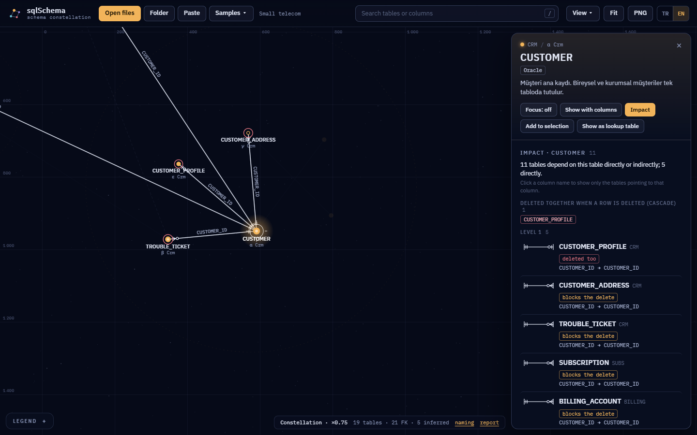

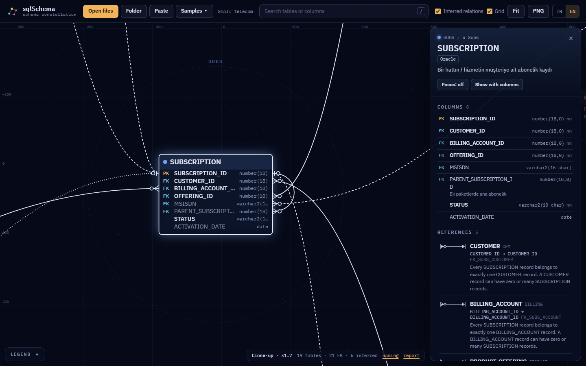

#### Crow's foot

The mark at the end of a line tells how many records can exist on that side. The mark next to the table is the upper bound; the outer one is the lower bound.

| Mark | Meaning | How it is derived from the schema |
|---|---|---|
| `──‖` | exactly one | FK column is `NOT NULL`; owner of an embedded document |
| `──○┼` | zero or one | FK column is nullable, or the FK is also a PK/UNIQUE (1:1) |
| `──○<` | zero or many | default for the table holding the FK; arrays of ObjectIds |
| `──┼<` | one or many | DDL cannot enforce it (it needs a trigger or application rule), so it is never drawn |

#### Lines, stars and tags

| Line | Meaning |
|---|---|
| Solid | Declared foreign key or Mongoose `ref` |
| Long-dashed | Relationship declared with a `@ref` tag in the column comment (see below) |
| Dashed | Inferred relationship (see below); can be turned off in the **View** menu |
| Dotted | Disabled FK (`DISABLE`, `RELY DISABLE NOVALIDATE`, T-SQL `NOCHECK`) |
| Dash-dot | MongoDB embedded document: the sub-document lives inside its owner |

| Star | Meaning |
|---|---|
| Filled star | Table; size = number of links, colour = schema |
| Ring | Junction table (M:N): its PK is made of two FKs, or it is a pure link table |
| Small faded star | Satellite: an embedded MongoDB sub-document, placed next to its owner |
| Dashed ring | Referenced by an FK but not defined in the files |

On cards, **PK** marks a primary key, **FK** a foreign key and **CK** a Cassandra clustering key. A faded column name means the column is nullable.

**Constellations.** A small schema is one constellation. Large schemas are split by table-name prefix (`CUSTOMER_*`, `INVOICE_*`) and by links. Each star gets a Bayer-style designation by brightness within its constellation (`α Billing`, `β Billing`). The layout is deterministic: the same files always give the same map.

**Inferred relationships** are drawn dashed in two cases:
- No FK is declared, but the column name equals another table's primary key: `CDR.SUBSCRIPTION_ID` → `SUBSCRIPTION.SUBSCRIPTION_ID`.
- An `X_ID` / `xId` column points to a table X whose key is `ID` or `_id`: `orders.customerId` → `customers._id`.

They are not drawn when the types disagree or when there is more than one candidate.

**Relationships from comments: `@ref`.** Some relationships cannot be declared as FKs. The most common case is columns that point to only one type in a generic lookup table (`SOZLUK`: `ID`, `TIP_ID`, `AD`). The database cannot express "only rows where `TIP_ID = 7`". Such relationships are added to the map with a tag in the column comment:

```sql
COMMENT ON COLUMN ABONE.DURUM_ID IS 'Subscriber status. @ref SOZLUK.ID (TIP_ID = 7)';
COMMENT ON COLUMN SESSION_LOG.USERID IS 'The user ID. @ref USERS';
```

| Syntax | Meaning |
|---|---|
| `@ref TABLE` | To the target's primary key |
| `@ref TABLE.COLUMN` | To a specific column of the target (read as `SCHEMA.TABLE` when `TABLE.COLUMN` does not exist) |
| `@ref SCHEMA.TABLE.COLUMN` | With the schema |
| `… (CONDITION)` | The condition in parentheses is written on the line and in the panel |

- **Where it is read:** the tag can be anywhere in the comment. Oracle and PostgreSQL `COMMENT ON COLUMN`, MySQL inline `COMMENT '…'` and SQL Server `sp_addextendedproperty` descriptions are all read.
- **On the map:** these relationships are not guesses but the DBA's statement; they are drawn long-dashed and tagged "from comment" in the panel.
- **With an FK:** if the column already has an FK, only the condition is added to it.
- **Errors:** a target that cannot be found is listed as a warning in the parse report.

In the insurance sample, status columns point to the generic code table (`KOD_TABLO`) this way.

**Lookup tables.** When hundreds of columns point to a generic code table, the lines swamp the map and the lookup becomes a giant hub. So a table that is the target of at least two **conditional** relationships counts as a lookup table:
- **On the map:** lines to it are not drawn. On the card, a `→ KOD_TABLO` badge replaces the column type. The line is drawn only while the lookup or the referencing table is selected or hovered.
- **In the layout:** lookup relationships do not pull tables together, so the lookup does not sit in the middle of the schema and squeeze the rest.
- **In the panel:** selecting the lookup shows a **Lookup usage** section listing which columns use which condition (`KOD_TIP = 'POLICE_DURUM'` → `POLICE.POLICE_DURUM`).
- **By hand:** the **Show as lookup table** / **Not a lookup table** button in the panel overrides the automatic choice; it is remembered in the browser.
- **As lines:** **View → Draw lookup links** always draws the lines.

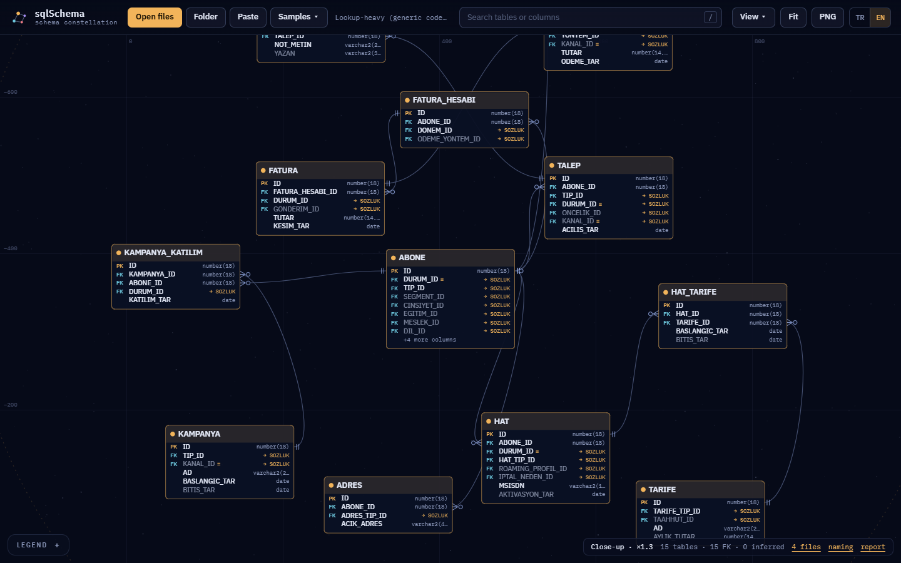

In the **Lookup-heavy** sample, more than 30 columns point to a single `SOZLUK` table.

**Code values.** The meaning of codes is not always kept in a separate table; often it is written straight into the column comment:

```sql
COMMENT ON COLUMN MUSTERI.MUSTERI_TIP IS 'G = Gerçek kişi, T = Tüzel kişi';
COMMENT ON COLUMN HASAR_IHBAR.IHBAR_KANAL IS 'Channel of the claim: ACN = Agency, CAG = Call centre, WEB = Online branch';
```

- **Recognised forms:** `1 = Active, 2 = Passive` · `A: Active; P: Passive` · `Y-Yes / N-No` · `Status (1=Active, 2=Passive)` · `0 => off, 1 => on`.
- **Against false matches:** at least two pairs, the same separator and short, code-like codes are required. "Note: old field, Source: SAP" or "Version 2 = new format" is not a list.
- **In the panel:** the values appear as chips under the column; the part of the comment outside the list ("Channel of the claim") is shown separately.
- **On the card:** a small `≡` next to the column name.
- **In search:** the meanings of values are searched too. Typing "iptal" finds the column holding `4 = İptal`; case and Turkish characters are ignored.

Allowed values may be defined elsewhere too; all of them are shown with the same chips, with the source next to them:

| Source | Example |
|---|---|
| `CHECK` constraint | `CHECK (MUSTERI_TIP IN ('G', 'T'))` · SQL Server: `CHECK (([Gender]='F' OR [Gender]='M'))` |
| `ENUM` type | MySQL `status enum('active','passive')` |
| MongoDB `enum` | `enum: ['tr', 'en']` in `$jsonSchema` and Mongoose fields |

When the values come from a constraint or type and their meanings are written in the comment, the two are combined: `CHECK (MUSTERI_TIP IN ('G','T'))` with the comment `'G = Gerçek kişi, T = Tüzel kişi'` shows as `G Gerçek kişi · T Tüzel kişi`. Ranges (`BETWEEN`), comparisons (`> 0`) and multi-column conditions are not value lists.

**Lookup data.** If the files also contain the `INSERT` rows of the lookup table, a column linked with `@ref SOZLUK.ID (TIP_ID = 7)` shows the values of that type (`1 Aktif · 2 Pasif …`; source: "from the lookup: SOZLUK · TIP_ID = 7"):
- **Code and meaning:** the code comes from the link's target column, the meaning from a column such as `AD`, `ACIKLAMA` or `NAME`.
- **Condition:** only `COLUMN = value` equalities (several joined with `AND`) are applied.
- **Unconditional lookup link:** no values are shown, because it is not known which type of the lookup applies. For plain FKs to small tables that are not lookups, all rows of the table become values.
- **Limits:** only plain `INSERT … VALUES` is read, not `INSERT … SELECT`. For large data dumps the first 2,000 rows per table are taken. `INSERT`s are still not drawn and are counted in the report.
- **Priority:** the column's own `CHECK` or comment list comes first; meanings missing there are filled in from the lookup.

<a id="en-multi-file"></a>

### Multiple files and migrations

All files are merged into one model and names are resolved at the end. So these cases just work:
- an FK in one file pointing to a table in another
- `constraints.sql` sorting before `ddl.sql`

The **N files** link in the bottom-right corner opens the file list. There you can:
- include or exclude individual files
- see each file's dialect and table count
- turn on "separate database"

**One constellation per file.** When a schema's tables come from more than one file, each file's tables gather in their own constellation. Teams usually split modules into files, so the map keeps that split.
- **Kept apart:** constellations of different files stay clearly apart even when they are related.
- **Boundary and name:** each constellation is outlined with a thin circle, with its name above the outline.
- **Name:** taken from the file path; files with the same name are told apart by their folders (`POLICE/tablolar`, `HASAR/tablolar`).

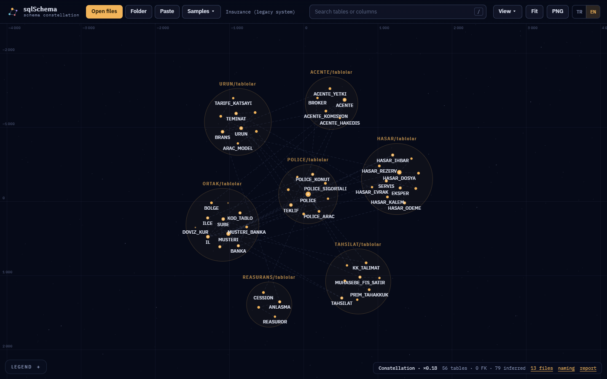

In a migration folder a file is a version, not a module; there, and for MongoDB, tables are grouped by name prefix and relationships. **View → Constellations** changes the choice by hand: *Automatic*, *By file* or *By name and relationships*.

**Reading order** follows the conventions of migration tools:

| Tool | Files | Behaviour |
|---|---|---|
| Flyway | `V1__init.sql`, `V1_1__x.sql`, `V2__y.sql` | By version number (V10 after V2). `R__*.sql` last, `U*__` undo scripts skipped. |
| golang-migrate, dbmate | `000001_x.up.sql` | `.down.sql` skipped. |
| Timestamped | `20240115093000_x.sql` | By time. |
| Numbered / other | `01_tables.sql`, `a2.sql < a10.sql` | Natural name order. |

Migrations are applied from first to last, and the map shows the **final state** of the schema. These statements are applied:
- `RENAME TO`, `RENAME COLUMN`
- `DROP TABLE`, `DROP COLUMN`, `DROP CONSTRAINT`
- `ALTER COLUMN … TYPE`, `MODIFY`, `CHANGE`
- T-SQL `sp_rename`, MySQL `RENAME TABLE`

**Schema diff.** **compare** in the bottom bar compares the open files (after) with an earlier version (before):
- **Earlier version:** in a migration folder, pick a version ("as of V7"), or choose the files / folder of the earlier version separately (for example a production dump and a test dump).
- **On the map:** added tables are green, removed ones red, changed ones yellow; renamed tables have a blue ring. Unchanged tables stay in the background. Removed tables also appear in place on the map.
- **In the panel:** the difference for the selected table: added, removed and changed columns (type, NULL, PK), renamed columns, PK and FK differences. Added and changed column rows are tinted on the card.
- **Rename guesses:** tables are matched by the similarity of their column sets (`customer` → `customers`), columns by type and name similarity (`weight` → `weight_grams`); guesses are labelled as such. The FK of a renamed column is not counted as changed.
- **Report:** **Download Markdown** writes the change list to a file for release notes or reviews.
- **Link:** `?diff=V3` opens the comparison with that version of a migration folder.


**Timeline.** In a migration folder, **Timeline** in the **compare** window plays the versions in order:
- **A stable map:** the layout is built once from the tables of every version. When the step changes, tables stay in place and the camera does not move; only the tables that exist in that version are drawn.
- **Each step is a diff:** the tables that version added, changed and removed compared with the previous one appear in the schema-diff colours. The **compare** window gives that step's list and Markdown report.
- **Navigation:** the slider, the ‹ › buttons or the `,` / `.` keys; ▶ plays the versions one after another.
- **Table history:** the selected table's panel lists the versions in which it was created, changed and dropped (`V4__plural_table_names name: shipment → shipments`). Clicking a row goes to that version. A renamed table stays selected.
- **Link:** `?time=V4` opens the timeline at that version.

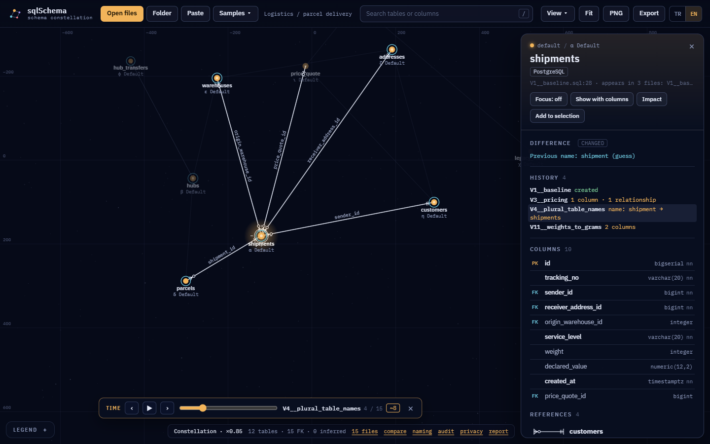

**Separate databases.** When files of different dialects are opened together (for example orders in MySQL, a catalogue in MongoDB and reporting in PostgreSQL), each folder is drawn as its own galaxy.

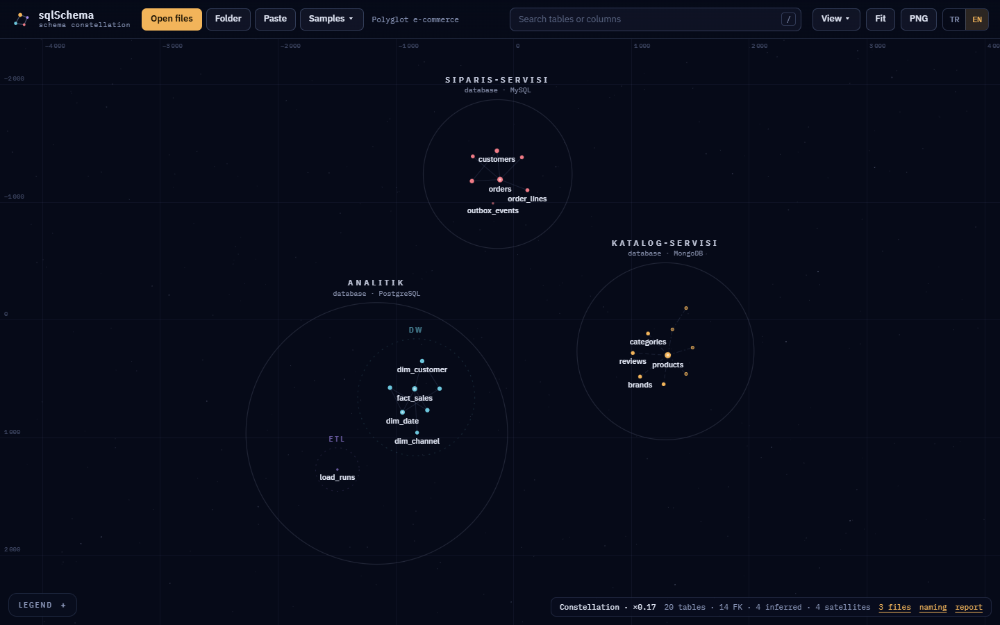

<a id="en-databases"></a>

### Supported databases

| | Oracle | SQL Server | MySQL / MariaDB | PostgreSQL | SQLite | Cassandra |
|---|---|---|---|---|---|---|
| `CREATE TABLE`, inline and table-level constraints | ✓ | ✓ | ✓ | ✓ | ✓ | ✓ `PRIMARY KEY ((a, b), c)` |
| `ALTER TABLE … ADD CONSTRAINT` | ✓ | ✓ `WITH CHECK/NOCHECK` | ✓ | ✓ `ONLY` | | |
| Column changes | `MODIFY` | `ALTER COLUMN` | `MODIFY`, `CHANGE` | `ALTER COLUMN … TYPE` | | |
| Renames and drops | `RENAME`, `DROP` | `sp_rename`, `DROP` | `RENAME TABLE`, `DROP` | `RENAME`, `DROP` | `RENAME`, `DROP` | |
| `CREATE UNIQUE INDEX` (1:1 detection) | ✓ | ✓ | ✓ | ✓ | ✓ | |
| Table / column comments | `COMMENT ON` | `sp_addextendedproperty` | `COMMENT '…'` | `COMMENT ON` | | |

**How the database type is recognised.** You do not have to choose it; each file is scored only on expressions **specific** to one database, and the highest score wins:

| Database | Hints looked for |
|---|---|
| Oracle | `VARCHAR2`, `NUMBER(…)`, `TABLESPACE`, `SYSDATE`, `PCTFREE`, `NOVALIDATE`, a `/` on its own line |
| SQL Server | `[dbo]`, `GO` on its own line, `NVARCHAR`, `IDENTITY(…)`, `CLUSTERED`, `DATETIME2`, `sp_addextendedproperty` |
| MySQL / MariaDB | `` `backticks` ``, `ENGINE=`, `AUTO_INCREMENT`, `DEFAULT CHARSET`, `UNSIGNED`; MariaDB from the dump header |
| PostgreSQL | `SERIAL`, `::type`, `$$`, `TIMESTAMPTZ`, `JSONB`, `OWNER TO`, `character varying`, `ALTER TABLE ONLY` |
| SQLite | `AUTOINCREMENT`, `WITHOUT ROWID`, `PRAGMA` |
| Cassandra | the `.cql` extension, `CREATE KEYSPACE`, `WITH CLUSTERING ORDER`, `frozen<`, `map<` |

Types found in every database, such as `DATE`, `INTEGER` or `VARCHAR`, cannot tell databases apart and are not counted. A plain `CREATE TABLE` file without hints takes the dominant type of the other files in its folder. MongoDB files are recognised by extension and content (`$jsonSchema`, `new Schema(…)`, JSON documents).

**Not drawn.** Views, sequences, triggers, packages, procedures, functions, types, grants and `INSERT`s are counted in the report but not drawn (`INSERT … VALUES` rows are read only for [lookup values](#en-reading)). The parser does not trip over the `;` inside them:
- PL/SQL blocks are kept whole up to the `/` line.
- T-SQL blocks are kept whole up to the `GO` line.
- MySQL blocks are kept whole up to the `DELIMITER` mark.

**Also handled:**
- SQL\*Plus commands
- Oracle storage and partition clauses
- PostgreSQL `$$` bodies and `PARTITION OF` children
- CQL `//` comments and `map<text, int>` types

**Encoding.** Files may be UTF-8, UTF-16 (the SSMS default) or Windows-1254; the encoding is detected automatically.

<a id="en-mongodb"></a>

### MongoDB

MongoDB has no DDL. The schema is taken from three sources; a collection that appears in several of them is merged into one table.

| Source | Example | What is read |
|---|---|---|
| mongosh scripts (`.js`) | `db.createCollection('x', { validator: { $jsonSchema } })`, `collMod`, `createIndex(…, { unique })` | Fields, types, required fields, descriptions, `enum` values |
| Mongoose models (`.js`, `.ts`) | `new Schema({ author: { type: ObjectId, ref: 'User' } })` | Fields and `ref` relationships. Collection names follow Mongoose's pluralisation rules. |
| Sample documents (`.json`, `.jsonl`, `.ndjson`) | `mongoexport` output | Union of fields across the first 5,000 documents; Extended JSON (`$oid`, `$date`) |

Embedded objects and arrays of objects become **satellite** tables (`users.profile`, `orders.items`) placed next to their owner.

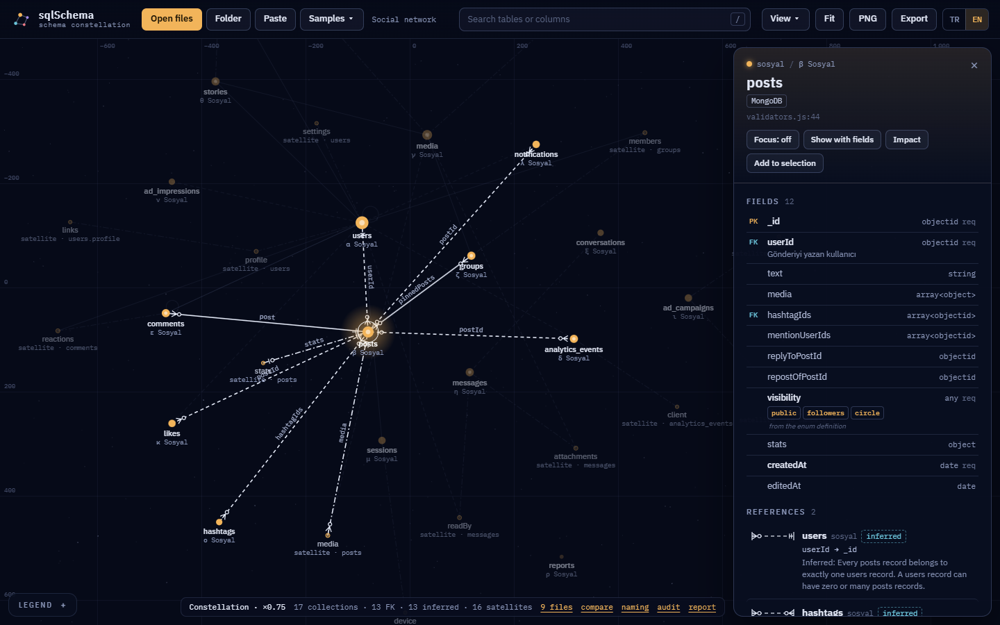

<a id="en-naming"></a>

### Naming profile

When a team has no written naming standard, the first step is to see what the schema actually uses. The **naming** link in the bottom-right corner counts names along these dimensions and shows their shares:

| Dimension | Patterns |
|---|---|
| Table and column name case | `UPPER_SNAKE`, `lower_snake`, `PascalCase`, `camelCase` |
| Primary key name | `ID`, `<TABLE>_ID`, `<TABLE>_NO / _CODE`, unrelated to the table name |
| Foreign key column | `<TARGET>_ID`, `<TARGET>_NO / _CODE`, role prefix (`SENDER_CUSTOMER_ID`, `AGENT_USER_ID → APP_USER`), same as the target PK, role name only (`OWNER`), not containing the target name (`CHZ_REF`) |
| Table name | singular / plural (estimated), prefixes such as `TBL_` |
| Characters and length | Turkish / non-ASCII characters, names longer than 30 characters |

- Each dimension lists the **dominant pattern** and the names that **do not follow it**. Clicking a name selects its table.
- If the most used pattern has less than 60%, it is not called dominant; the window shows **no clear dominant pattern**. A 51% to 49% split means the schema has two separate habits.
- **Scope** computes the profile for a single schema, which separates the habits of different modules.
- The **consistency** score is the average share of names that follow the dominant pattern in each dimension.
- **Download Markdown** writes the profile to a file to share with the team.

The tool imposes no rule: whether `ID` or `<TABLE>_ID` is right is the team's decision.

**Not counted in the shares:**
- Composite PKs, 1:1 tables whose PK comes from the parent, and tables without a PK. These are shown separately.
- Audit columns such as `CREATED_BY`, `UPDATED_BY`, `GUNCELLEYEN` and `KAYIT_KULLANICI`. They point to the user table but follow their own established pattern; they are counted separately.
- Inferred relationships: only declared FKs are counted, because inferred ones are already based on names.
- The `_id` and `ref` fields of MongoDB collections.

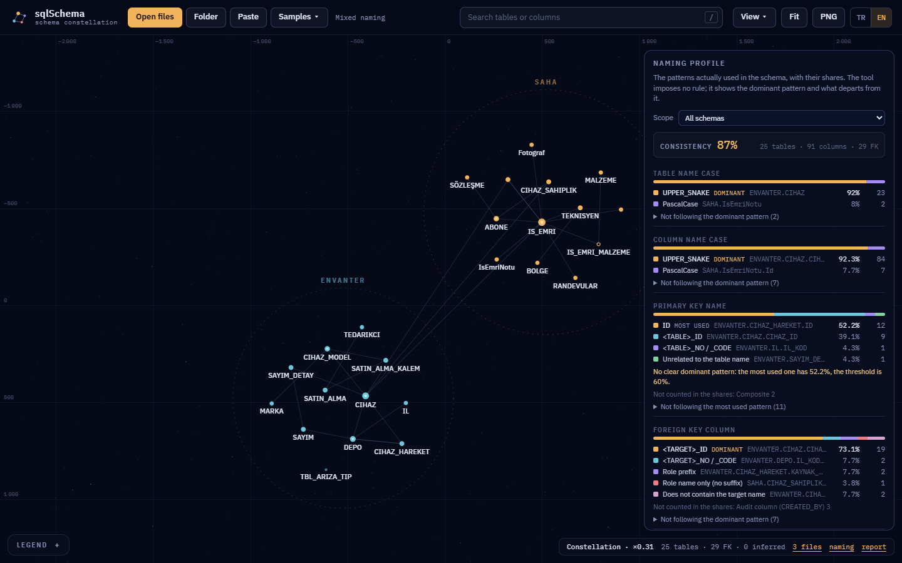

The **Mixed naming** sample was made for this feature: an Oracle schema to which two teams added tables with different habits.

<a id="en-audit"></a>

### Design audit

**audit** in the bottom bar scans the schema for common design mistakes. Each finding says three things:
- **What:** "column `BASLANGIC_TAR` is `VARCHAR2(20)`"
- **Why it matters:** with dates as text, range queries cannot use indexes and sorting is wrong
- **Suggestion:** use `DATE` or `TIMESTAMP`

The rules fall into four groups:

| Group | Example rules |
|---|---|
| Keys and integrity | table without a PK, FK and target column types differ, undeclared relationship, FK without an index, circular FK chain, redundant index, disabled FK, unresolved `@ref` target |
| Data types | dates and numbers as text, `FLOAT` amounts, oversized text, `CHAR` for variable data, `CLOB` for short text, same-named columns with different types, booleans in different formats (E/H, Y/N, 0/1) |
| Normalisation | repeating columns like `PHONE1, PHONE2, PHONE3`, comma-separated lists, key-value (EAV) tables, very wide tables |
| Naming | names over the limit (30 on Oracle 12.1 and earlier), reserved words, Turkish characters, system names like `SYS_C0012345`; PK, FK and case outliers from the dominant pattern |

- **Severity:** error, warning and info. Rules that reason from names (text dates, amounts, EAV ...) are marked **guessed from names**.
- **To keep false alarms down:**
  - Missing PKs and FKs on log, history and fact tables (`_LOG`, `_HIST`, `_CDR`, `FACT_`) are treated as deliberate.
  - Text dates are normal on SQLite.
  - Role-named FKs (`BILLING_ADDRESS_ID`) and text natural keys (`CURRENCY_CODE`) are not counted as outliers.
  - If the files contain no index definitions at all, FK indexes are not checked.
- **Show on map:** tables with errors are red, with warnings yellow; the rest stay in the background. Column rows with findings are tinted on the card.
- **In the panel:** the selected table's findings and suggestions are in the **Audit** section.
- **In the window:** the ten tables with the most findings are listed. **Download Markdown** writes every finding with its reason and suggestion into a review document.
- **With the timeline:** the audit is recomputed at each version, so you can see which migration brought a finding.
- **Link:** `?audit=1` shows the audit on the map, `?pop=audit` opens the window.

**Debt register: forgive the past, audit the future.** In a messy database the first audit finds hundreds of problems, and fixing hundreds of old tables at once is not realistic.
- **Accepting:** **Accept current findings as debt** in the window records the current findings. Recorded findings sit in a separate **Accepted debt** list, are not counted as errors and are not coloured on the map. From then on only new findings stand out: a table without a PK brought by a new migration shows up at once.
- **Progress:** fixed findings count as **paid-off debt**; a bar shows how much of the debt has been paid.
- **Sharing with the team:** **Download project file** writes the debt register (and saved views) to `<name>.sqlschema.json`. Put it in the schema folder and commit it: everyone who opens the folder sees the same debt. The file does not contain the schema.
- **Storage:** the register is also kept in the browser under the project name, so it survives new migrations. Between the folder's file and the browser's copy, the newer one wins.
- **Identity:** a finding is matched by rule, table and column name. If a table is renamed, its findings count as new.

**Fix suggestions.** **Fix script** in the window generates dialect-specific SQL for the findings that can be fixed (Oracle, PostgreSQL, SQL Server, MySQL / MariaDB, SQLite):
- **What is generated:**
  - missing FKs and FK indexes, with `ENABLE NOVALIDATE` on Oracle, `NOT VALID` on PostgreSQL and `WITH NOCHECK` on SQL Server as an option
  - enabling a disabled FK (with a query that finds orphan rows first)
  - dropping a redundant index
  - adding a PK (the column name follows the schema's dominant PK naming)
  - widening an FK column
  - converting text dates, text numbers, `FLOAT` amounts and `CLOB`s: new column, copy, verify, drop the old column, rename
  - renaming system-named constraints and columns with Turkish characters, a different case or an unclear name
- **Risk:** each suggestion is marked **safe** (indexes, FKs, constraint names), **review** (adding a PK, dropping an index, widening a type) or **risky** (data conversion, renames). Risky ones are left out of the script by default.
- **Notes:** each step carries an explanation ("change the date format to match your data", "application code using this name must be updated too"). Validation steps to run after the data is cleaned are written as comments. Steps that rename a table come last.
- **Fixed by hand:** no SQL is generated for cycles, EAV, repeating columns or findings that need a new name to be chosen; they need a design decision.
- **Use:** with a debt register, SQL is generated for new findings only. The script is copied or downloaded as `.sql`. In the panel, each finding also shows its own SQL.
- **Tested:** the tests add the generated script to the samples as a new migration and audit again, checking that the fixed findings disappear and no new ones appear.

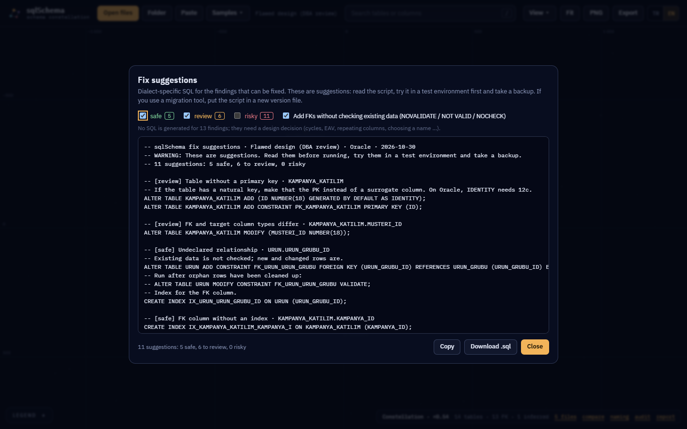

**Change review (PR).** To catch problems in a new migration's PR before they reach production:
- **Opening:** with a comparison (before → after) or the timeline active, **Review report** in the **compare** window. The audit window also shows a summary of the change at the top.
- **What counts:** findings in "after" but not in "before" came with this change; the reverse were resolved. Renamed tables are matched, so an old finding does not reappear as "new" under a new name. Findings in the debt register are not counted. If a rule could not run before (the dump had no indexes) but runs after, its findings on unchanged tables are not counted as new.
- **Report:** Markdown to paste into a PR comment: added, changed and removed table counts, new findings by severity, and resolved findings. Optionally, safe and review-level fix SQL in a collapsible section.
- **Link:** `?diff=V14&review=1` opens the report.

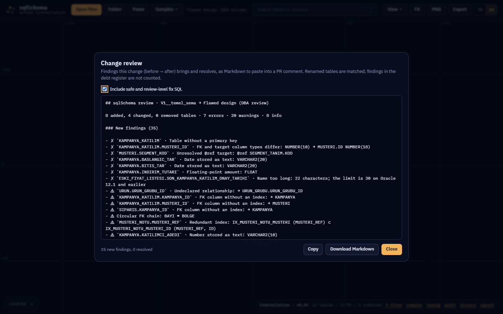

**Command line and CI.** The same audit, debt register and change review run without a browser, so PRs are not skipped when reviewing by hand:

```bash
node tools/sqlschema-lint.js db/migration --since V15 --format md --fail-on error
```

| Option | Purpose |
|---|---|
| `<file\|folder>...` | the schema to check; folders are scanned recursively |
| `--since V15` | review V15 and later in a migration folder (before = the versions before V15) |
| `--baseline <path>` | review against this copy (e.g. the main branch's schema) |
| `--project <file>` | debt register; by default `*.sqlschema.json` in the folder is read |
| `--format text\|md\|json\|sarif` | text, Markdown for PR comments, JSON, or SARIF for GitHub code scanning |
| `--fail-on error\|warning\|info\|none` | exit code 1 if there are new findings at this severity (default `error`) |
| `--fix <file>` | write the safe and review-level fix SQL to a file |
| `--out <file>`, `--lang tr\|en`, `--separate` | output file, language, treat folders as separate databases |

- Exit code: 0 below the threshold, 1 for new findings at or above it, 2 for usage errors or when no schema is found.
- Findings in the debt register and (in review mode) findings that existed before the change do not count towards the threshold.
- Node 18+ is enough; there are no dependencies. Files are only read and no network requests are made; the schema does not leave the team's machine or CI server.

GitHub Actions example: writes the findings a PR brings as a comment, fails the check on errors and uploads SARIF to code scanning. The same command runs in GitLab CI and Jenkins.

```yaml
name: sqlSchema
on: pull_request
permissions: { contents: read, pull-requests: write, security-events: write }
jobs:
  schema-review:
    runs-on: ubuntu-latest
    steps:
      - uses: actions/checkout@v4
        with: { fetch-depth: 0 }
      - uses: actions/setup-node@v4
        with: { node-version: 20 }
      # pin to a release tag
      - run: git clone --depth 1 --branch main https://github.com/umitkrkmz/sqlSchema.git ../sqlschema
      - run: git worktree add ../base origin/${{ github.base_ref }}
      - run: node ../sqlschema/tools/sqlschema-lint.js db/migration --baseline ../base/db/migration --format md --out review.md --fail-on error
      - if: always()
        run: gh pr comment ${{ github.event.pull_request.number }} --body-file review.md
        env: { GH_TOKEN: ${{ github.token }} }
      - if: always()
        run: node ../sqlschema/tools/sqlschema-lint.js db/migration --baseline ../base/db/migration --format sarif --out sqlschema.sarif --fail-on none
      - if: always()
        uses: github/codeql-action/upload-sarif@v3
        with: { sarif_file: sqlschema.sarif }
```

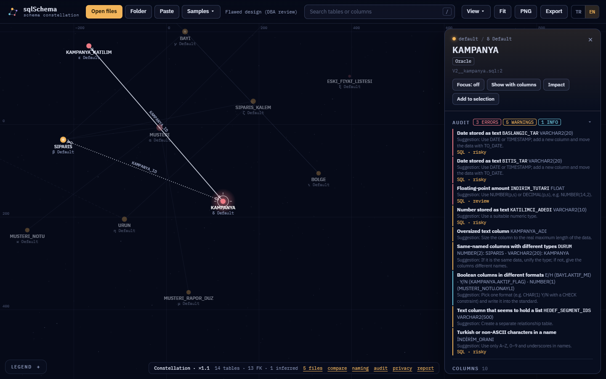

The **Flawed design (DBA review)** sample was made for this feature: migrations three developers carelessly added to a clean baseline. Every rule fires at least once.

<a id="en-samples"></a>

### Samples

The samples under `samples/` are **synthetic**: they do not belong to any real organisation. Each imitates the typical structure of a sector and the real export format of a tool. Open them from the **Samples** menu.

| Sample | Database | Scenario |
|---|---|---|
| Small telecom | Oracle | 20 tables, embedded in the app |
| Telecom BSS/OSS | Oracle | SQL Developer dump in one file: 318 tables, 16 schemas, partitions, triggers, packages |
| Telecom, one file per schema | Oracle | The same schema split into 16 files; all FKs in the final file |
| Core banking | SQL Server | SSMS "Generate Scripts": UTF-16, `GO`, `IDENTITY`, descriptions |
| Insurance (legacy system) | Oracle | A folder per module, Turkish names, no FKs at all |
| Marketplace e-commerce | MySQL | `mysqldump --no-data`, a `DELIMITER` procedure |
| Hospital information system | PostgreSQL | OMOP CDM layout: tables, PKs, FKs, indexes and comments in separate files |
| Logistics / parcel delivery | PostgreSQL | Flyway, 14 versions: renamed and dropped tables, partitioning |
| IoT telemetry | Cassandra | Two keyspaces, table-per-query design |
| Social network | MongoDB | `$jsonSchema` + Mongoose + `mongoexport` |
| Field service mobile app | SQLite | `sqlite3 .dump`, offline cache |
| Polyglot e-commerce | MySQL + MongoDB + PostgreSQL | Microservices, one galaxy per folder |
| Mixed naming | Oracle | Two teams, two habits: PK `ID` and `<TABLE>_ID`, irregular FKs, ORM tables |
| Lookup-heavy | Oracle | Every code lives in a single `SOZLUK` table; more than 30 columns point to it with `@ref` |
| Flawed design (DBA review) | Oracle | Careless migrations added to a clean schema; every audit rule fires |

<a id="en-export"></a>

### Exporting a schema

| Database | How |
|---|---|
| Oracle, SQL Developer | *Tools → Database Export*, DDL only. The "separate files per object type" output can be opened as a folder. |
| Oracle, SQL\*Plus / SQLcl | The `DBMS_METADATA` script below |
| SQL Server | SSMS → database → *Tasks → Generate Scripts* (schema only) |
| MySQL / MariaDB | `mysqldump --no-data mydb > schema.sql` |
| PostgreSQL | `pg_dump --schema-only mydb > schema.sql` |
| SQLite | `sqlite3 app.db .schema > schema.sql` |
| Cassandra | `cqlsh -e "DESCRIBE KEYSPACE telemetry" > schema.cql` |
| MongoDB | Validator scripts, the Mongoose models folder, or `mongoexport --limit 1000` output |

For projects that use migrations, open the `db/migration` folder as it is.

```sql
-- Oracle: DDL and comments from the data dictionary
SET LONG 20000000 LONGCHUNKSIZE 20000000 PAGESIZE 0 LINESIZE 32767 TRIMSPOOL ON FEEDBACK OFF
EXEC DBMS_METADATA.SET_TRANSFORM_PARAM(DBMS_METADATA.SESSION_TRANSFORM, 'SQLTERMINATOR', TRUE);
EXEC DBMS_METADATA.SET_TRANSFORM_PARAM(DBMS_METADATA.SESSION_TRANSFORM, 'SEGMENT_ATTRIBUTES', FALSE);
SPOOL schema.sql
SELECT DBMS_METADATA.GET_DDL('TABLE', table_name, owner) FROM all_tables WHERE owner IN ('CRM', 'BILLING');
SELECT DBMS_METADATA.GET_DEPENDENT_DDL('COMMENT', table_name, owner) FROM all_tables t
 WHERE owner IN ('CRM', 'BILLING')
   AND (EXISTS (SELECT 1 FROM all_tab_comments c WHERE c.owner = t.owner AND c.table_name = t.table_name AND c.comments IS NOT NULL)
     OR EXISTS (SELECT 1 FROM all_col_comments c WHERE c.owner = t.owner AND c.table_name = t.table_name AND c.comments IS NOT NULL));
SPOOL OFF
```

<a id="en-language"></a>

### Language

The interface is available in Turkish and English. On first visit Turkish is chosen if the system language is Turkish, English otherwise. Switch with the **TR / EN** buttons in the top-right corner; the choice is remembered in the browser. Use `?lang=tr` or `?lang=en` to pin the language in a link.

**Shareable links.** URL parameters open a sample, a table and a zoom level directly:

```
index.html?lang=en&sample=telekom&select=BILLING_ACCOUNT&zoom=0.9&legend=0
```

Add `pop=naming`, `pop=report` or `pop=files` to open a window on load. `center=TABLE` centres a table without selecting it.

<a id="en-development"></a>

### Project layout and development

```
index.html          page shell, legend
style.css           styles
js/                 loaded in this order; each file adds to the globalThis.sqlSchema namespace
  i18n.js           Turkish / English dictionaries, language selection
  lexer.js          tokenizer, statement splitter, dialect detection
  sql-parser.js     DDL → ordered operation list (create, fk, rename, drop ...)
  mongo.js          the same operation list from $jsonSchema, Mongoose and JSON documents
  files.js          file ordering (Flyway, golang-migrate), parser selection
  model.js          applies operations: tables, relationships, cardinality, junctions, inference
  diff.js           difference of two models: tables, columns, PK, FK; rename guesses; timeline
  layout.js         database → schema → constellation → star, hierarchical force layout
  conventions.js    naming profile: patterns, shares, names that depart from the dominant pattern
  audit.js          design audit: rules and findings (returns codes; text lives in the UI)
  fixes.js          fix suggestions: dialect-specific SQL, risk level
  sample-small.js   embedded small sample
  render.js         canvas drawing, camera, crow's feet
  ui.js             loading, file list, search, panel, report, URL parameters
samples/            synthetic samples and catalog.js (generated)
tools/              sample and screenshot generators, sector definitions
tests/run.js        checks every sample, parser edge cases and translations
docs/images/        README images (tr/ and en/)
```

Development commands (Node 18+, no dependencies):

```bash
node tests/run.js                                  # tests
node tools/gen-samples.js                          # regenerate samples/
node tools/screenshots.js http://localhost:8000/   # refresh README images (needs Chrome)
```

The parser, model, layout and naming profile never touch the DOM and can be `require`d in Node. `window.sqlSchema` is exposed for inspection in the console:

```js
sqlSchema.S.model.tables.filter(t => t.junction).map(t => t.name)
sqlSchema.loadText('CREATE TABLE a (id int PRIMARY KEY);', 'test.sql')
```

<a id="en-limitations"></a>

### Limitations

- Views and relationships expressed only through views are not drawn.
- Inferred relationships rely on column names only; schemas with inconsistent naming can produce missing or extra links. In MongoDB, fields such as `authorId` that do not match a collection name are not linked.
- `CREATE TABLE … AS SELECT` tables appear without columns.
- When a MongoDB schema comes from sample documents, only fields seen in those documents are listed.
- Dynamic Mongoose schemas built from variables (`new Schema(buildFields())`) are not read.

<a id="en-contributing"></a>

### Contributing, security, license

- Contribution guide: [CONTRIBUTING.md](CONTRIBUTING.md)
- Code of conduct: [CODE_OF_CONDUCT.md](CODE_OF_CONDUCT.md)
- Reporting a vulnerability: [SECURITY.md](SECURITY.md)
- Changelog: [CHANGELOG.md](CHANGELOG.md)
- Project guide for AI coding agents: [AGENTS.md](AGENTS.md)

When reporting a bug, please do not share a schema that belongs to a real organisation; renaming the tables is enough.

Released under the [MIT](LICENSE) license.

<p align="right"><a href="#en">↑ back to top</a></p>
